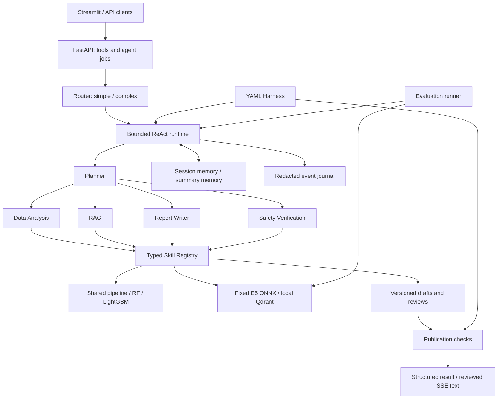

# SmartHealth Agent

[](https://github.com/rensabella/smart-health-agent/actions/workflows/checks.yml)

**Typed domain tools, bounded multi-agent execution, evidence-linked reporting, and measurable failure cases.**

[中文文档](README.md) · [Project report](docs/project_report.md) · [Evaluation results](evaluation/evaluation_report.md) · [Deployment guide](docs/deployment.md)

SmartHealth Agent turns a physiological CSV analysis pipeline into a tool layer for an AI agent system. It combines signal validation, windowed feature extraction, RandomForest/LightGBM prediction, local knowledge retrieval, and reviewed report generation behind FastAPI and a Streamlit workbench.

The engineering focus is explicit contracts, execution limits, traceability, and evaluation. This is a local, single-process portfolio implementation designed around production concerns. Its datasets are synthetic; its scores are not disease probabilities. External LLM performance, container execution, clinical validity, and production load capacity have not been established.

## What the project demonstrates

- **Skills–Agent separation:** nine independently testable Skills expose Pydantic input/output schemas through a registry; domain computation stays outside agent prompts.
- **Five-role ReAct runtime:** Planner, Data Analysis, RAG, Report Writer, and Safety Verification choose actions through structured decision contracts. A router handles simple requests without entering the full report workflow.
- **Bounded execution:** YAML policies control role permissions, tool-call budgets, delegation, deadlines, and report revisions. Failed calls consume budget.
- **Evidence-linked publication:** reports bind the current analysis, evidence, draft version, and policy hash. Review and deterministic checks must pass before report text enters SSE.
- **Operational behavior:** startup model reuse, temporary artifact ownership checks, idempotent jobs, cancellation, SSE replay, redacted audit events, and expiring memory.
- **Honest evaluation:** system, retrieval, citation-support, safety, and timing metrics include denominators and a retained semantic-review failure.

## Architecture



| Skill | Responsibility |
|---|---|
| `csv_analysis` | Validate an uploaded CSV and return a dataset reference |
| `signal_processing` | Clean signals within bounded windows |
| `feature_extraction` | Produce versioned features using the shared training/inference pipeline |
| `anomaly_prediction` | Predict window scores with a loaded baseline model |
| `feature_explanation` | Return global importance and explicitly scoped local evidence |
| `visualization` | Generate PNG artifacts tied to the analysis |
| `rag_retrieval` | Retrieve traceable source passages and similarity scores |
| `report_generation` | Create or revise a claim-based draft linked to evidence |
| `safety_verification` | Record claim judgments and apply publication constraints |

The base configuration enables six data Skills. `configs/report/` explicitly enables all nine and the five-role workflow. Roles have separate permissions; they may share one model backend, so this does not imply independent model consensus. Missing capabilities fail explicitly rather than producing mock results.

## Quickstart: data tools and UI

Use Python 3.10+; local verification used Python 3.12.14 on macOS arm64. Run commands from the repository root. LightGBM requires an OpenMP runtime: `libomp` on macOS or `libgomp1` on Debian/Ubuntu.

Use an editable installation from a source checkout. Configuration and knowledge resources currently use the source layout; a standalone wheel installed away from the checkout is not a supported deployment method.

```bash
git clone https://github.com/rensabella/smart-health-agent.git
cd smart-health-agent
python3 -m venv .venv
source .venv/bin/activate
python -m pip install -e '.[dev,ui]'
mkdir -p data/generated/matplotlib-cache
export MPLCONFIGDIR="$PWD/data/generated/matplotlib-cache"
python generate_demo_data.py
python train.py
uvicorn app.main:app --host 127.0.0.1 --port 8000 --workers 1 \
  --limit-concurrency 16 --no-access-log --log-config configs/logging.json
```

The generator produces labeled synthetic training sessions and a separate, unlabeled `data/sample/demo.csv`. Training shares preprocessing and feature extraction with inference, splits by subject, selects thresholds on validation data, and saves both baseline model bundles with metadata and checksums. Existing bundles are not overwritten; use a new `--output-dir` for another experiment. Model binaries are generated locally and excluded from version control.

In another terminal, activate the same virtual environment:

```bash
curl --fail-with-body http://127.0.0.1:8000/health
curl --fail-with-body http://127.0.0.1:8000/ready
curl --fail-with-body -X POST http://127.0.0.1:8000/predict \
  -F 'file=@data/sample/demo.csv'
curl --fail-with-body -X POST \
  'http://127.0.0.1:8000/analyze?include_visualizations=true' \
  -F 'file=@data/sample/demo.csv'
export HEALTH_API_BASE_URL=http://127.0.0.1:8000
python -m streamlit run frontend/streamlit_app.py \
  --server.address=127.0.0.1 --server.port=8501
```

Open the API documentation at `http://127.0.0.1:8000/docs` and the UI at `http://127.0.0.1:8501`. The Tool API works without an LLM. Agent decisions are disabled by default and require explicit backend configuration. If `HEALTH_API_TOKEN` is set, provide it as a bearer token or in the UI sidebar; without it, data access is local-only.

`requirements-py312.lock` records the verified Python package versions. It is a local environment snapshot, not a cross-platform lock with wheel hashes. Train models in the environment that will load them; the loader checks protocol and dependency compatibility. See [installation and training details](README.md).

### Input and result semantics

Uploads are UTF-8 CSV files of at most 5 MiB, each representing one subject's continuous session. Required columns are `heart_rate`, `EDA`, `EEG_feature`, `activity`, and `sleep_quality`. The protocol uses 1 Hz samples and 30-second windows; `EEG_feature` is a synthetic feature proxy, not a raw EEG waveform. Short gaps are filled within windows, while excessive missingness or invalid values are rejected.

The pipeline extracts 35 features. `risk_score` is the maximum synthetic anomaly-model score across windows, not a calibrated health or disease probability. Global feature importance is separate from local evidence: LightGBM uses native margin contributions, while RandomForest reports reference deviations without claiming SHAP or causality.

[Example JSON](docs/example/api_analysis.json) · [Training report](docs/example/training_report.json)


## Reproduce a report without an API key

Prepare the baseline models above, then explicitly download the pinned embedding model and build the local index:

```bash
python -m scripts.build_knowledge_index --download-model
python -m examples.run_report
```

The first download is approximately 487 MB. Subsequent runs can operate offline. Model and index files are not committed, startup does not download them, and the builder refuses to overwrite an existing index. Stop any API or other process using the same local Qdrant directory before running these examples.

This example uses **real LightGBM, E5 ONNX, and Qdrant with explicitly scripted role decisions**. Its review mode is `scripted_test`, and it makes no external LLM requests. Generated artifacts go to `data/generated/report_example/`; checked-in synthetic examples are available under [docs/report_example](docs/report_example/).

For a live tool-calling provider, follow [RAG and report configuration](docs/rag_and_reports.md) and [Agent Loop documentation](docs/agent_loop.md). Enable `configs/report/`, local RAG, and `HEALTH_AGENT_BACKEND=openai_compatible`, then supply the provider URL, model, and credentials through environment variables. `.env.example` documents settings; the application does not automatically load `.env`. Never commit credentials.

The knowledge base contains eight attributed project-curated notes. Retrieval scores measure cosine similarity, not evidence correctness. Report text is streamed only after review, as chunks of a fixed approved report; it is not an unreviewed model-token stream. The runtime permits at most two draft revisions before blocking publication.

## Evaluation and verification

After preparing the models and index, stop processes using the same Qdrant directory and run:

```bash
python -m evaluation.run_eval
python -m evaluation.run_eval --fail-on-regression
```

The committed evaluation was run on **2026-09-09 (Asia/Shanghai)** using real domain/retrieval models and scripted decisions, with zero external provider requests. It was not rerun during the 2026-10-12 publication preparation.

| Measure | Recorded result |
|---|---:|
| System scenario contracts / expected completed tasks | 14/14 / 8/8 |
| Workflow type and objective matches | 14/14 |
| Successful Skill calls | 44/45 |
| Retrieval hits, top-k=3 with threshold 0.78 | 8/8 |
| Supported published claim–source pairs | 3/4 |
| Safety decisions matching reference labels | 7/8 |
| Unsafe published claims / all published claims | 1/4 |

One failed Skill call is an intentional invalid-CSV case. The retained safety failure, `unsupported_sleep_equivalence`, shows that optimistic scripted judgments and deterministic guards can publish an unsupported claim. Therefore the current baseline returns exit code 1 with `--fail-on-regression`. Tests verify that this failure is measured; passing tests do not establish semantic safety.

Labels await independent review, and the suite is small. Full generated reports lack independently labeled semantic judgments. Model first-token latency is **not measured** because the decision adapter is non-streaming; recorded local timing excludes model loading and is not a production HTTP benchmark. Live evaluation is explicit (`--backend live`) with a shared request cap and no scripted fallback.

[Metric definitions](docs/evaluation.md) · [Case provenance](docs/evaluation_cases.md) · [JSON results](evaluation/evaluation_report.json) · [Markdown results](evaluation/evaluation_report.md)

```bash
python -m pytest
ruff check app skills scripts evaluation frontend tests examples train.py generate_demo_data.py
ruff format --check app skills scripts evaluation frontend tests examples train.py generate_demo_data.py
python -m pip check
```

On **2026-10-12**, the local rerun passed **499 tests in 21.80 seconds**; Ruff lint, formatting for 126 Python files, and dependency checks passed. Fast tests use labeled scripted decisions and test embeddings, alongside real baseline training fixtures and local Qdrant. Historical real-E5 and HTTP/SSE verification is documented separately in [Step 8](docs/step8_verification.md) and [Step 9](docs/step9_verification.md).

## Repository guide

| Path | Contents |
|---|---|
| `app/pipeline/`, `app/models/`, `app/services/` | Shared transformations, predictor interface, domain services |
| `skills/`, `app/schemas/` | Registry, nine adapters, typed contracts |
| `app/agents/`, `app/harness/`, `configs/` | Router, runtime, provider adapter, permissions and budgets |
| `app/rag/`, `knowledge/`, `scripts/` | Embeddings, retrieval, attributed corpus, index building |
| `app/reports/`, `app/memory/` | Draft/review lifecycle and expiring memory |
| `app/api/`, `frontend/` | FastAPI endpoints and Streamlit HTTP/SSE client |
| `evaluation/`, `tests/`, `examples/` | Evaluation suite, regression tests, explicit local examples |
| `docs/`, `Dockerfile`, `docker-compose.yml` | Design/verification records and deployment configuration |
| `.github/workflows/checks.yml` | Python checks and container build workflow |

## Deployment boundaries and next work

The [deployment guide](docs/deployment.md) describes explicit data/model/index preparation and API/UI startup. Docker configuration uses a non-root user, separate volumes, resource limits, and a read-only root filesystem. Container build/runtime validation remains pending; configuration and static checks do not establish a working deployment.

Use one API worker: artifact storage, sessions, and job execution are local to a process, and local Qdrant directories have process-level ownership. The current API token represents one principal, not a multi-user authentication system. Long-term memory stores summaries and explicit preferences rather than raw uploads; audit events omit raw CSV, draft text, and hidden model reasoning.

Next validation priorities are independently reviewed labels, live-provider planning and safety evaluation, harder retrieval negatives, container execution, HTTP load tests, and authenticated multi-user infrastructure with shared job state. The project does not train an LLM, medical VLM, or reinforcement-learning policy.

## Contributing

Describe the failing behavior and a reproducible synthetic example in an issue or pull request. Add focused tests for changed contracts or execution behavior, run the checks above, and update documentation when configuration or scope changes. Keep real health records, credentials, model binaries, generated indexes, and local runtime logs out of contributions. Preserve evaluation failures and their denominators rather than removing difficult cases to improve reported scores.

See [CONTRIBUTING.md](CONTRIBUTING.md), [SECURITY.md](SECURITY.md), and the [publication and portfolio checklist](docs/portfolio_checklist.md). An open-source license has not yet been selected for the original code; public visibility alone does not grant unrestricted reuse rights. Third-party source notes retain their own attribution and terms.
