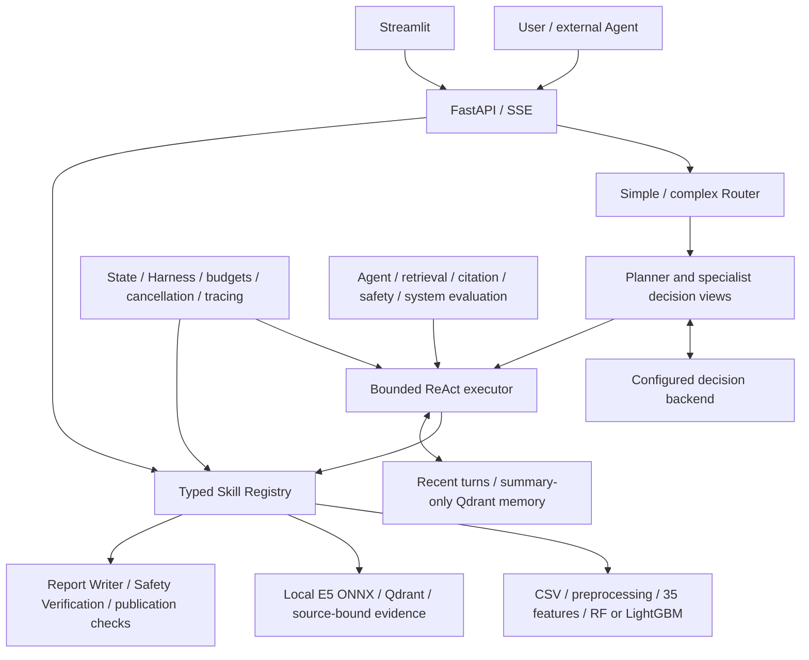

# SmartHealth Agent

[](https://github.com/rensabella/smart-health-agent/actions/workflows/checks.yml)

Typed physiological analysis tools, bounded Agent execution, local retrieval,
evidence-linked reports and reproducible evaluation — packaged as a Python application.

[Architecture](docs/architecture.md) · [Deployment](docs/deployment.md) ·
[Evaluation](docs/evaluation.md) · [Recorded results](evaluation/evaluation_report.md) ·
[中文项目报告](docs/project_report.md)

## Motivation

A physiological analysis pipeline becomes useful to an Agent when its inputs,
outputs, permissions and failure modes are explicit. SmartHealth takes the CSV,
anomaly-detection and report workflow from an earlier smart-home project and
exposes it through the same typed Skills to HTTP clients and a ReAct executor.

This repository emphasizes engineering boundaries: preserve deterministic domain
computation, keep model decisions observable, validate tool outputs, bind report
claims to evidence, and measure failures. The `0.2.0` package migration preserves
the existing business logic and HTTP contracts. It adds an installable `src`
package, validated Settings, structured execution spans and wheel-level checks.

## Architecture



See [architecture.md](docs/architecture.md) for module ownership, the migration
map, log semantics and remaining process boundaries.

## Key features

- **Nine independently callable Skills** with strict Pydantic schemas and a
  Registry shared by the API and Agent executor.
- **Five roles** — Planner, Data Analysis, RAG, Report Writer and Safety Verification
  — with role allowlists, bounded delegation and observation-driven decisions.
- **Real domain computation:** shared cleaning and feature extraction, trained
  RandomForest/LightGBM bundles, risk-score semantics, feature explanations and PNG plots.
- **Explicit retrieval:** pinned multilingual E5 ONNX, a verified local Qdrant
  index, source metadata and insufficient-evidence outcomes.
- **Controlled reports:** claims reference evidence; publication requires the
  current analysis, evidence, draft version, policy and safety-review bindings.
- **Operational controls:** deadlines, cancellation, bounded workers, idempotent
  jobs, replayable SSE, summary retention and privacy-safe journals.
- **Observable execution:** task/role/Skill IDs, start/end timestamps, outcomes,
  safe errors, request latency and model version; secrets and raw input stay out of logs.
- **Installable application:** one `smarthealth` namespace, bundled read-only
  resources, console entry points, pytest, Docker/Compose and GitHub Actions.

The default backend is disabled. The real provider adapter requires explicit
configuration. Scripted adapters are labeled test/example controls and are never
an automatic substitute for an unavailable LLM. Models and indexes are not
downloaded at application startup.

## Repository layout

```text
src/smarthealth/
  agents/          # planner.py, executor.py, router.py, provider contracts/adapters
  skills/          # base_skill.py, registry.py, validation.py, nine real Skills
  runtime/         # state, guards, events, tracing, Harness and Memory
  retrieval/       # embedding protocol, E5 ONNX, vector-store protocol, Qdrant index
  api/             # application factory, Tool/Agent/Memory endpoints and SSE
  config/          # validated environment Settings and resource paths
  pipeline/        # original shared preprocessing and feature extraction
  models/          # original predictors and trusted bundle loader
  services/        # domain operations and artifact lineage
  reports/         # claim, draft, review and publication contracts
  explain/ visualization/ schemas/
  frontend/        # Streamlit and HTTP/SSE client
  evaluation/      # versioned cases, runner and metrics
  cli/             # API/UI, generation, training and index entry points
  examples/        # explicitly scripted demonstrations
  resources/       # default policies, knowledge and synthetic fixtures
configs/ knowledge/       # reviewed operator examples; packaged copies are checked
app/ skills/ frontend/    # compatibility entry points for existing source users
scripts/                  # compatibility index entry + isolated wheel check
examples/ evaluation/     # compatibility entries and recorded evaluation artifacts
tests/ docs/
pyproject.toml requirements.txt .env.example
Makefile Dockerfile docker-compose.yml
```

The wheel contains only `smarthealth`; root compatibility entry points remain for
existing source-checkout commands. New code imports `smarthealth.*`.

## Installation

Python 3.10+ is required; the exercised environment is Python 3.12. Linux needs
`libgomp1`; macOS LightGBM needs the OpenMP runtime (for example, `brew install libomp`).

```bash
git clone https://github.com/rensabella/smart-health-agent.git
cd smart-health-agent
python3 -m venv .venv
source .venv/bin/activate
python -m pip install -e '.[dev,ui]'
```

`pyproject.toml` is the dependency source of truth. `requirements.txt` installs the
runtime package from this checkout without duplicating dependency ranges. The
existing `requirements-py312.lock` is a historical environment snapshot, not a
portable lock for this release.

For wheel installation outside the checkout, use the [deployment guide](docs/deployment.md).
No open-source license has been selected yet; public visibility does not grant an
MIT or Apache license. Third-party knowledge retains its documented attribution.

## Quick start

From the repository root, with the virtual environment activated:

```bash
make data
make train
smarthealth-api
# Second terminal, same virtual environment:
smarthealth-ui
```

The API listens on `127.0.0.1:8000`; the UI uses port 8501. The default Tool
pipeline needs neither an external LLM nor an embedding download. Training refuses
to overwrite a model bundle; use `smarthealth-train --output-dir models_saved/new_run`
and set `HEALTH_MODEL_DIR` for a new experiment.

```bash
curl http://127.0.0.1:8000/health
curl -X POST http://127.0.0.1:8000/analyze \
  -F 'file=@data/sample/demo.csv'
```

`/predict` returns the prediction, score, important features and model metadata.
`/analyze` adds quality, explanation and visualization references. Existing response
schemas and error codes are retained. A [recorded synthetic result](docs/example/api_analysis.json)
shows the full response; scores describe the synthetic anomaly model, not clinical risk.

## Example Agent workflow

Run the existing explicitly scripted demonstration against real domain Skills:

```bash
python -m smarthealth.examples.run_agent \
  --csv data/sample/demo.csv \
  --model-dir models_saved/lightgbm_v1.0
```

The Planner delegates analysis. The Data Analysis role invokes CSV validation,
signal processing, feature extraction, prediction, explanation and visualization,
then returns observed results. The executor applies budgets and publication checks
throughout. This demonstrates tool execution and control flow, not live LLM reasoning.

To enable a real tool-calling provider, export `HEALTH_AGENT_BACKEND=openai_compatible`,
`HEALTH_LLM_BASE_URL`, `HEALTH_LLM_MODEL` and `HEALTH_LLM_API_KEY`. For a full
retrieval-backed report, also prepare E5/index assets and select the report Harness
as described in [RAG and reports](docs/rag_and_reports.md) and [deployment](docs/deployment.md).
Live calls require your own credentials and incur provider charges; no paid run is
performed by installation or the default demo.

## Configuration and observability

`smarthealth.config.settings.Settings` reads validated `HEALTH_*` environment
variables. Use `HEALTH_HOME` for mutable state, or override model, memory, trace
and retrieval paths individually. Set `HEALTH_LOG_LEVEL` to control application
logs. `.env.example` documents variables; the application does not auto-load it.

JSON execution logs contain `task_id`, `agent_name`, `skill_name`, `start_time`,
`end_time`, `status`, `error_code` and `error_message`. Role-level spans have no
Skill name; direct API Skills use `tool_api`. Existing request IDs, event journals
and SSE IDs are preserved. See [trace semantics](docs/architecture.md#runtime-layer).

## Testing and packaging

```bash
make check                 # Ruff, pytest and dependency consistency
make package-check         # build + install wheel outside the checkout + real ML/API smoke
make docker-build          # requires Docker Engine / Desktop
```

The existing 499-test suite covers real model fixtures, independent Skills,
permissions, cancellation, routing, memory isolation, RAG integrity, report
publication, HTTP/SSE and Streamlit. New regression tests cover settings, resource
packaging, compatibility and execution spans. The isolated wheel check additionally
trains a real baseline and exercises `/health`, `/ready`, `/predict` and `/analyze`
without importing the source checkout. It reuses installed third-party dependencies.

The refactor's [cloud run](https://github.com/rensabella/smart-health-agent/actions/runs/38275517363)
passed **523 tests**, Ruff, dependency checks, wheel installation/runtime smoke and
Docker image build at source commit `3c7175d`. Local and cloud evidence, warning
counts and verification limits are recorded in
[package verification](docs/package_verification.md). Markdown-only follow-up
commits skip CI; container runtime and live LLM quality remain unverified.

## Evaluation and limitations

An opt-in [live LLM evaluation framework](docs/LIVE_LLM_EVALUATION.md) exercises
the existing production Runtime with 20 reviewed synthetic tasks, shared request/
token/estimated-cost limits, isolated fault injection, deterministic graders and
JSONL/Markdown reports:

```bash
smarthealth-eval-live --dry-run --max-tasks 20 --output evaluation/live_runs/first-dry-run
```

Dry-run is the default and issues no provider calls. Real inference requires an
explicit `--live` invocation, credentials, prepared local assets and an approved
spending budget. **Live LLM quality has not yet been measured.** Infrastructure
tests and router-only outcomes remain separate from provider-exercised results.
See the [implementation verification](docs/LIVE_LLM_EVALUATION_VERIFICATION.md).

The [recorded evaluation](evaluation/evaluation_report.md) preserves scripted/live
provenance, denominators, evidence and failures. It uses real ML/E5/Qdrant, with
scripted role decisions. It includes a known semantic-review failure; engineering
checks do not establish medical safety or clinical accuracy.

- Synthetic physiological data only; `EEG_feature` is a feature proxy. No clinical
  validation, real-population calibration or medical diagnosis claim.
- External LLM quality has not been benchmarked. First model-token latency is not
  inferred from SSE report delivery.
- One API worker and local process-owned Qdrant directories. There is no shared job
  queue, distributed memory, tenant-aware authentication or implemented remote DB adapter.
- Docker configuration and image-build evidence are separate from container asset
  preparation, startup, SSE/restart and load validation.
- Default policy/corpus copies need synchronized review. Root legacy import shims
  are migration compatibility, not a second business implementation.

The [benchmark plan](docs/evaluation.md#future-benchmark-design) and
[portfolio checklist](docs/portfolio_checklist.md) track the remaining work.

[Contributing](CONTRIBUTING.md) · [Security](SECURITY.md)
