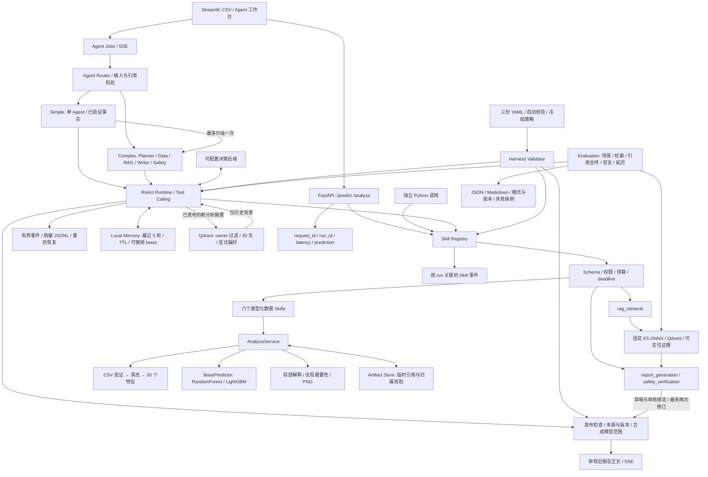
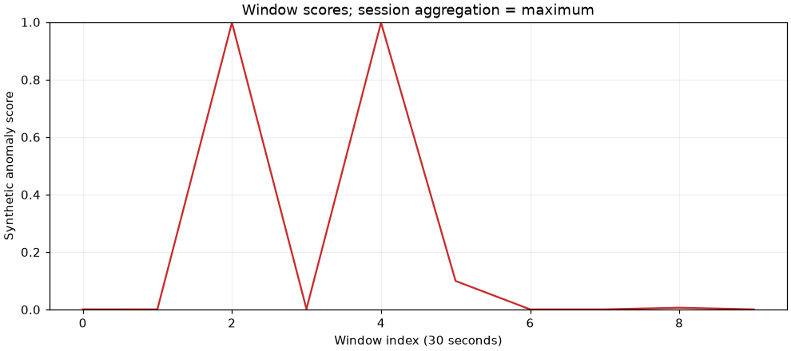

# SmartHealth Agent — Tools, Multi-Agent Workflows & Evaluation

[](https://github.com/rensabella/smart-health-agent/actions/workflows/checks.yml)

[English overview](README.en.md) · [项目报告](docs/project_report.md) · [评测结果](evaluation/evaluation_report.md) · [运行与部署](docs/deployment.md) · [求职补充清单](docs/portfolio_checklist.md)

将“中国移动智慧家庭异常检测与 LLM 智能诊断平台”的生理数据分析业务，重构为可由 Agent 调用的类型化能力层。系统处理 CSV、清洗信号、提取窗口特征、运行异常模型，并输出可追溯的预测、解释和图表。

项目材料：[完整项目报告](docs/project_report.md) · [简历描述与面试表达](docs/resume_project.md)。

**当前已实现至 Step 9：Agent/RAG/Safety/System Evaluation、Streamlit、Docker Compose 和 CI 配置。** 五个角色通过九个类型化 Skills 执行分析、检索、逐条主张写作和独立角色审核；报告必须绑定当前分析、证据、草稿版本和策略哈希，通过发布检查后才输出正文。知识检索使用固定版本的本地 multilingual-e5-small ONNX 与 Qdrant，原有 Tool API 保持兼容。详见 [RAG 与报告文档](docs/rag_and_reports.md) 和 [Step 9 验证记录](docs/step9_verification.md)。

已有 [Memory](docs/memory_layer.md)、[Router](docs/agent_router.md)、[ReAct Loop](docs/agent_loop.md) 与 [Harness](docs/harness_engineering.md) 提供有界执行、来源校验、审计及发布门禁。当前是面向生产工程设计的本地单进程实现。本次评测使用真实 LightGBM/E5/Qdrant 和明确标记的脚本角色决策，保留一条语义审核失败；没有执行外部 LLM 调用、Docker 构建运行或多用户压测，不能据此声称已满足生产或临床质量要求。

## Start here

| 想了解的内容 | 入口 |
|---|---|
| 系统能做什么 | 下方架构图、[完整项目报告](docs/project_report.md)、[合成报告正文](docs/report_example/report.txt) |
| 工程能力 | 9 个类型化 Skills、5 种角色、权限/预算/产物来源检查、审核后 SSE |
| 可复现证据 | [训练结果](docs/example/training_report.json)、[系统评测](evaluation/evaluation_report.md)、[真实 HTTP/SSE 记录](docs/report_example/http_smoke.json) |
| 本地运行 | Installation → Training → API example → Streamlit；基础工具不需要外部 LLM |
| 已知边界与待补充 | [Evaluation 定义](docs/evaluation.md)、[求职补充清单](docs/portfolio_checklist.md) |

2026-10-12 本机复验：**499 项测试通过**，Ruff 和依赖检查通过。训练与 RAG/Agent 的已保存结果来自 2026-09-09，未因本次发布准备而重新测量。模型二进制、真实健康数据、凭据、本地数据库和第三方参考工程不随本仓库发布。

## Architecture



Skill 契约与业务计算分离。Registry 在执行前后校验 Pydantic schema；模型在应用启动时加载一次。预处理及特征工程由训练和推理共享，模型包校验输入协议、特征顺序和依赖版本。

| Skill | 输入 | 输出 |
|---|---|---|
| `csv_analysis` | `upload_ref` | `dataset_ref`、数据质量 |
| `signal_processing` | `dataset_ref` | `window_set_ref`、清洗记录 |
| `feature_extraction` | `window_set_ref` | `feature_set_ref`、特征版本 |
| `anomaly_prediction` | `feature_set_ref` | `prediction_ref`、分数、窗口结果 |
| `feature_explanation` | `prediction_ref`、`top_k` | `analysis_ref`、全局重要性、局部证据 |
| `visualization` | `analysis_ref`、`plot_types` | 有归属约束的 PNG 引用 |
| `rag_retrieval` | `analysis_ref`、`query`、`top_k` | 证据引用、命中状态及知识/模型版本 |
| `report_generation` | 分析与证据引用、带证据 ID 的主张、可选修订引用 | 草稿引用、版本与哈希 |
| `safety_verification` | 当前草稿与证据哈希、逐条主张审核判断 | 审核引用、`safe`、`warnings`、`revision_needed` |

每个 Skill 都有 `name`、`description`、`version`、`input_schema`、`output_schema` 和 `execute()`。完整 JSON Schema 可通过 `registry.describe()` 查看；`registry.tool_definitions(allowed_skills)` 导出工具描述。默认 `configs/` 注册六个数据 Skills；`configs/report/` 显式注册九个。检索或报告依赖缺失时返回明确错误，不使用假结果回退。

```text
app/
  api/                    # HTTP 上传、预测、分析、健康检查
  core/                   # 上下文、预算、临时产物、审计、上传限制
  pipeline/               # 训练与推理共享的转换
  models/                 # BasePredictor、RF、LightGBM、可信模型加载
  services/               # 领域操作与产物血缘
  schemas/                # 版本化响应契约
  agents/                 # Router、决策契约、后端、ReAct runtime、事件 journal
  memory/                 # MemoryManager、本地会话、Qdrant、摘要 schema
  harness/                # 严格 YAML、不可变策略、执行与发布检查
  rag/                    # 语料分块、固定 ONNX embedding、Qdrant 检索与完整性校验
  reports/                # 版本化主张、审核记录、发布构造
  explain/ visualization/
skills/                   # BaseSkill、Registry、九个适配器
configs/                  # 基础策略；report/ 为五角色报告策略
knowledge/                # 有来源的初始语料、归属和哈希 manifest
frontend/                 # Streamlit；独立 HTTP/SSE 客户端与发布门禁
evaluation/               # 标注用例、scripted/live runner、实际评测结果
scripts/build_knowledge_index.py
data/sample/demo.csv
models_saved/             # 本地生成；模型二进制不提交 Git
examples/run_skills.py
examples/run_agent.py      # 明确标记的脚本决策 + 真实 Skills 示例
examples/run_routing.py    # 六种自动路由场景 + 真实 LightGBM
examples/run_memory.py     # 真实 Qdrant 持久化、重启、删除与上下文示例
examples/run_report.py     # 真实 E5/Qdrant/LightGBM + 明确标记的脚本五角色
tests/
docs/example/             # 实际运行生成的合成样例
generate_demo_data.py
train.py
Dockerfile
docker-compose.yml        # API / Streamlit；显式资产准备 profile
.github/workflows/checks.yml
```

## Installation

要求 Python 3.10+；本次在 macOS arm64、Python 3.12.14 验证。先克隆仓库，后续命令均在仓库根目录执行：

当前支持从源码 checkout 以 editable 模式安装，或使用保留源码布局的 Docker 镜像。配置和知识语料相对于源码目录读取，暂不提供脱离源码目录的独立 wheel 部署；模型由本地训练/显式下载步骤准备。

```bash
git clone https://github.com/rensabella/smart-health-agent.git
cd smart-health-agent
python3 -m venv .venv
source .venv/bin/activate
python -m pip install -e '.[dev,ui]'
mkdir -p data/generated/matplotlib-cache
export MPLCONFIGDIR="$PWD/data/generated/matplotlib-cache"
```

macOS 的 LightGBM 需要 OpenMP 运行库；缺少 `libomp.dylib` 时可安装 `brew install libomp`。参见 [LightGBM 官方安装说明](https://lightgbm.readthedocs.io/en/stable/Installation-Guide.html#macos)。Linux 需要可用的 OpenMP 运行库，例如 Debian/Ubuntu 的 `libgomp1`。

Python 3.12 可使用本次验证的精确包版本：

```bash
python -m pip install -r requirements-py312.lock
python -m pip install --no-deps -e .
```

该文件是 Python 包版本快照，未锁定 OS 库和 wheel 哈希，也不代表其他 Python/OS 组合已经验证。Python 3.10 请使用 `pyproject.toml` 的兼容范围解析依赖，并在同一环境重新训练。

## 数据协议

每次上传一个用户的一次连续会话，UTF-8 CSV，最多 **5 MiB**。必需列如下：

| 列 | 当前协议含义 |
|---|---|
| `heart_rate` | 心率，bpm，存在时必须大于 0 |
| `EDA` | 非负的合成皮电信号，生成器按类似 µS 的尺度模拟 |
| `EEG_feature` | 非负、无量纲的合成 EEG 特征代理；不是原始 EEG 波形 |
| `activity` | 0–1 活动强度上下文 |
| `sleep_quality` | 0–1 睡眠质量上下文，同一会话内固定 |

可选 `timestamp`、`subject_id`、`session_id`。时间戳必须严格连续、间隔 1 秒；缺少时明确按行顺序解释为 1 Hz。在线接口拒绝 `label`、额外列、重复列、混合用户/会话、无穷值和无效数字。

数据按 30 秒无重叠窗口处理。连续缺失超过 3 秒拒绝；每窗总缺失比例上限 15%，单通道上限 20%。短缺失仅在当前窗口内插值/边缘填充，不跨窗口借值。尾部不足 30 行丢弃并报告；异常高值不因偏离均值而被自动剪掉。窗口必须至少一个。

特征包含信号统计量、变化率、上下文与跨信号相关性，共 35 个。该输入协议不支持从 1 Hz 特征推断 HRV、EEG 频段或原始波形疾病特征。接入真实设备需新增明确的设备/采样协议和对应训练数据。

## Training

```bash
python generate_demo_data.py
python train.py
```

默认生成 60 个合成用户、每人 4 次会话、共 57,600 行；另用独立随机种子生成 300 行 `data/sample/demo.csv`。训练集包含模拟潜在事件标签，在线 demo 不包含标签。训练流程为：会话内共享清洗 → 30 秒特征 → 按用户分离的 train/validation/test → 训练 → 验证集选阈值 → 独立测试集评估 → 保存模型包。

两个 baseline 都是实际训练的分类器。输出包含 `estimator.joblib`、`metadata.json` 和 SHA-256 `manifest.json`，另有 `training_report.json`。模型包保留数据哈希、参数、特征协议、参考分布、用户划分与依赖版本。已有模型包不会被覆盖；重新训练时指定新的 `--output-dir`。

```bash
python train.py --model random_forest --output-dir models_saved/experiment_02
export HEALTH_MODEL_DIR="$PWD/models_saved/experiment_02/random_forest_v1.0"
```

默认运行使用 `models_saved/lightgbm_v1.0`。只允许加载管理员配置、可信本地训练的模型包；校验和用于检测损坏，不能证明 pickle 内容可信。更改 scikit-learn、LightGBM、NumPy 或 joblib 版本后应重新训练，不跳过兼容检查。

本次默认 seed=42 的独立测试集为 12 个合成用户、384 个窗口，其中 104 个异常窗口。完整结果见 [实际训练报告](docs/example/training_report.json)。

| 模型 | Average precision | ROC AUC | F1 | 验证集所选阈值 |
|---|---:|---:|---:|---:|
| RandomForest | 0.9836 | 0.9910 | 0.9515 | 0.51 |
| LightGBM | 0.9956 | 0.9978 | 0.9714 | 0.35 |

这些指标衡量对本项目合成生成器的拟合与泛化。EEG 代理在生成器中的信号较强，LightGBM 的全局重要性明显集中于它；这不构成真实 EEG 诊断价值的证据。当前分数未经过真实人群校准，也没有临床性能结论。

## API example

```bash
uvicorn app.main:app --host 127.0.0.1 --port 8000 --workers 1 \
  --limit-concurrency 16 --no-access-log --log-config configs/logging.json
```

另一个终端调用：

```bash
curl --fail-with-body http://127.0.0.1:8000/health
curl --fail-with-body http://127.0.0.1:8000/ready
curl --fail-with-body -X POST http://127.0.0.1:8000/predict \
  -H 'X-Request-ID: demo-predict-001' -F 'file=@data/sample/demo.csv'
curl --fail-with-body -X POST \
  'http://127.0.0.1:8000/analyze?include_visualizations=true' \
  -F 'file=@data/sample/demo.csv'
```

`GET /health` 固定返回 `{"status":"ok"}`。`GET /ready` 检查模型是否就绪；缺少或不兼容的模型使 `/ready`、`/predict`、`/analyze` 返回 503，服务不会静默使用假预测。OpenAPI 位于 `/docs`。

`POST /uploads` 仅创建临时上传引用，供后续 Agent 使用；当前 `/predict`、`/analyze` 直接接收 multipart CSV。图表返回相对 URL，含会话与输入版本；调用 `GET /artifacts/{ref}` 时保留这些参数。

配置 `HEALTH_API_TOKEN` 后，所有数据接口和图表都要求 `Authorization: Bearer <token>`。未配置时仅接受本地调用。当前是**单主体开发 API**：同一个 token 表示同一个主体；会话标识不是多用户认证。正式多用户部署仍需接入可信身份、用户级配额、TLS 和运行隔离。

## Example output

本次 demo 的 `/predict` 核心字段如下，数值来自默认 LightGBM 的实际推理。完整响应另有版本、临时引用、清洗记录和逐窗口结果。

```json
{
  "prediction": "anomaly",
  "risk_score": 0.9983188764750849,
  "risk_level": "high",
  "aggregation": "max",
  "window_count": 10,
  "anomalous_ratio": 0.2,
  "highest_risk_window": 2,
  "important_features": [
    {"name": "EEG_feature_mean", "importance": 0.7555926588697731},
    {"name": "sleep_quality_mean", "importance": 0.08345442442058167}
  ],
  "model": {"name": "LightGBM", "version": "1.0"}
}
```

`risk_score` 是所有窗口中最高的合成异常模型分数；它不是会话患病概率。`risk_level` 为项目展示分级：低于验证阈值为 low，达到阈值为 medium，达到 0.8 为 high。最高窗口使用从 0 开始的编号。

`important_features` 表示全局模型重要性：LightGBM 使用 gain，RF 使用 impurity importance。`/analyze.explanation` 另给最高分窗口的局部证据：LightGBM 使用原生 `pred_contrib`，带有符号的贡献单位为 raw margin；其所有贡献与 base value 之和等于 raw margin（返回的 top-k 子集不保证加和相等）。RF 返回相对于训练正常窗口的偏离，明确标记为 `reference_deviation_only`，不声称是 SHAP 或因果解释。完整 HTTP 响应见 [实际 API 样例](docs/example/api_analysis.json)。



## 独立调用 Skill

无需启动 API 或配置 LLM：

```bash
python examples/run_skills.py
```

该脚本在 `data/generated/example/` 写入结构化结果、三个 PNG、完整 Skill schema，以及一份按 run 导出的 JSONL trace。脚本明确用于合成数据，会主动将结果写到本地。已生成的审阅样例见 [analysis.json](docs/example/analysis.json) 和 [Skill manifests](docs/example/skill_manifest.json)。其中临时引用仅说明契约，原示例进程退出后不可再查询。

新 Skill 继承 `BaseSkill[InputModel, OutputModel]`，输入输出继承 `SkillModel`，实现有界 `execute(input, context)`，然后显式注册。依赖通过构造函数注入；身份、允许的 Skills、预算与截止时间由服务端 `SkillContext` 提供，不能放进 LLM 可写参数。应用使用 `await registry.execute(name, payload, context)` 获得统一 `SkillResult`；直接调用 `execute()` 仅用于可信代码的独立测试，不具有 Registry 的执行约束。

## RAG 与五角色报告

先显式下载固定的语义模型并构建知识索引，再运行无需 API key 的合成示例：

```bash
python -m scripts.build_knowledge_index --download-model
python -m examples.run_report
```

首次模型下载约 487 MB；随后运行可离线进行。已存在的索引不会被覆盖，模型/索引文件不提交 Git。实际报告、检索结果与 trace 见 [报告样例](docs/report_example/run.json)、[检索样例](docs/report_example/retrieval.json) 和 [验证记录](docs/step8_verification.md)。示例使用脚本决定角色动作，输出 `review_mode=scripted_test`，不能据此声称外部 LLM 审核有效。

真实 Agent 接入需同时配置 `HEALTH_HARNESS_CONFIG_DIR` 指向 `configs/report/`、`HEALTH_RAG_MODE=local`、模型及索引路径，以及 `HEALTH_AGENT_BACKEND=openai_compatible` 和 provider 凭据。调用方式沿用 `/uploads` → `/agent/runs` → SSE/snapshot，详见 [配置、API 与报告状态](docs/rag_and_reports.md)。启动不自动联网下载模型。

知识库当前为八份人工整理、带精确来源的信号/设备/指南/研究笔记。E5 的检索分数是余弦排序分数，不是证据正确率；材料只能提供一般知识，不能证明个体病因。Writer 的定性主张需要引用实际命中片段；Safety 对每条主张单独判断，另有来源、版本、明显诊断/用药指令等确定性守卫。最多两次修订，仍未通过则阻止正文发布。

SSE 的 `report.chunk` 只在发布检查通过后出现，正文来自已审核的固定报告，不是未经审核的 token 流。持久化事件仅保留索引和哈希；结果 TTL 到期或服务重启后，正文不再可回放。长期 Memory 只保存分析摘要及分数，不保存报告草稿和证据文本。

## Streamlit

先按前文启动 API，在另一个终端运行：

```bash
export HEALTH_API_BASE_URL=http://127.0.0.1:8000
python -m streamlit run frontend/streamlit_app.py \
  --server.address=127.0.0.1 --server.port=8501
```

打开 `http://127.0.0.1:8501`。数据工具页支持示例 CSV 下载、上传、快速预测、完整分析与图表；Agent 工作台支持简单问题、分析/报告任务、取消、SSE 进度和按 Run ID/Session ID 重连。后端配置了 token 时，在侧栏输入同一个 token；凭据仅保留在当前页面会话。

默认 API 的 Agent 决策后端关闭；数据工具可在模型就绪后使用，Agent 任务需先按上节配置决策后端及相应能力。页面不会自动启用脚本后端。报告只在服务端发布检查通过、快照与正文哈希一致后显示；执行中的草稿不进入页面，过期结果不能从旧 SSE 缓冲恢复。更多说明见 [前端文档](frontend/README.md)。

## Evaluation

准备模型与知识索引后，停止使用同一本地 Qdrant 目录的 API，再执行：

```bash
python -m evaluation.run_eval
# 可选：将任一未达预期的病例作为非零退出状态
python -m evaluation.run_eval --fail-on-regression
```

评测包含 14 个系统场景、8 个检索查询、8 个单主张安全病例，输出 [Markdown 报告](evaluation/evaluation_report.md) 与 [完整 JSON](evaluation/evaluation_report.json)。默认脚本模式的实际结果：

| 指标 | 本次结果 |
|---|---:|
| 系统场景契约 / 预期完成任务 | 14/14 / 8/8 |
| 路由类别和目标正确 | 14/14 |
| Skill 成功执行 | 44/45（故意输入无效 CSV 的调用仍计为失败） |
| 检索命中 | 8/8（top-k=3，阈值 0.78） |
| 已发布主张的引用支持精度 | 3/4 |
| 安全病例判断正确 | 7/8 |
| 不安全发布占已发布主张 | 1/4 |

失败病例 `unsupported_sleep_equivalence` 表明，乐观的脚本审核判断加上确定性守卫，仍可能放行证据不支持的主张；它被保留在报告中，当前 `--fail-on-regression` 会返回 1。标签尚待独立复核，这些小样本结果不代表真实 LLM 的效果。工具失败、正确拒绝、无输出和不适用指标分别计数，不以测试通过率替代 Agent 质量。

报告另外记录平均工具次数、运行延迟、首事件、审核后首报告块和顺序吞吐量。当前决策适配器不做模型 token streaming，因此首 token 延迟明确为 `not_measured`；本地预加载模型的顺序计时不作为 HTTP 生产吞吐量。真实 provider 可通过显式 `--backend live` 单独评估，有全局请求上限且配置缺失时不回退。本次外部请求数为 0。定义、复现方式与已知局限见 [Evaluation 文档](docs/evaluation.md)。

## Docker 与 CI

[Docker 部署文档](docs/deployment.md) 给出构建、合成数据/训练/E5 索引准备、API/Streamlit 启动及停止流程。镜像使用非 root 用户；Compose 配置只读根文件系统、独立数据卷、资源上限、健康检查和本机端口绑定。模型必须在镜像对应的依赖环境中训练；API 仍只运行一个 worker，当前没有 Redis 或独立 Qdrant 服务。

本机没有 Docker，镜像构建和容器运行尚未验证。[GitHub Actions 配置](.github/workflows/checks.yml) 提供 Python 测试、lint 和镜像构建任务；本目录是 Git 仓库根目录。远端发布及云端 CI 的实际状态见 [求职补充清单](docs/portfolio_checklist.md)。镜像构建通过也不等于容器运行验证。

## 可观测性与运行边界

应用 JSON 日志包含 `request_id`、`run_id`、路由模板、耗时、预测及模型版本；Skill 事件记录开始/完成/拒绝/失败、call ID、版本、输入输出字段名与预算用量。trace 不记录原始 CSV、具体生理值、完整参数或异常堆栈。传入请求 ID 有字符限制，底层框架访问日志默认在上述命令中关闭，避免写入带引用的查询 URL。

Registry 默认最多 4 个同时执行的 Skills。实际发起的调用原子计入预算，失败与重试同样占用；等待槽位期间超时的调用不计为已执行。同步任务超时后，底层线程可能仍在计算，槽位会保留至其真正结束；取消上下文阻止后续产物写入。线程不是可强制终止的沙箱；后续若接入不可信或可能卡死的计算，需要进程级 worker。

当前 Artifact Store 是单进程、有锁、读写复制隔离的临时内存存储；默认 TTL 一小时、最多 256 个条目、按序列化大小估算 64 MiB 容量，容量不足返回明确错误。它不是进程 RSS 硬上限。临时引用验证 owner、session、输入版本、类型及有效期。HTTP 文件在解析前有总量限制，解析后也独立检查单文件大小；框架解析 multipart 时可能暂时使用临时文件，上传关闭后清理。原始数据不写入长期记忆或 trace。

独立 Tool 的 Skill trace 仍保留最多 5,000 条内存事件，可显式导出。Agent 任务另有按 run 保存的脱敏 journal、SSE 回放和重启恢复：默认每 run 保留最近 512 条可回放事件，最多 128 个任务，审计保留上限 7 天；容量满时淘汰最旧的终态任务。原始输入不持久化，已发布结果仅在内存保留一小时。重启会将中断任务标为 failed，并恢复历史元数据与审计事件，`result_available=false` 表示原分析结果不可恢复。当前仍是单 API 进程，不支持跨 worker 共享运行状态或自动恢复模型执行。

## Tests

```bash
python -m pytest
ruff check app skills scripts evaluation frontend tests examples train.py generate_demo_data.py
ruff format --check app skills scripts evaluation frontend tests examples train.py generate_demo_data.py
python -m pip check
```

当前本机 **499 项测试通过**，Ruff lint/格式与 `pip check` 通过。测试 fixture 实际训练 RF 与 LightGBM，并使用真实本地 Qdrant；快速检索测试注入明确标记的测试向量器，无外部 LLM 或模型下载依赖。覆盖数据/Registry、ReAct、Router、SSE、journal、provider 协议、Memory、Harness、RAG 来源绑定、报告修订与发布门禁，以及 Evaluation 指标、前端 HTTP/SSE、Streamlit AppTest 和 Docker 静态约束。真实 E5 另通过运行示例与评测验证。7 条上游弃用提示来自 Starlette/AnyIO 以及 Streamlit 的 NumPy timedelta 调用，未导致测试失败；未隐藏这些提示。

Step 9 的前端浏览器检查实际验证了页面、上传及简单任务；完整报告展示另由 AppTest 验证，报告 HTTP/SSE 由真实 Uvicorn 验证。最终浏览器重连点击未完成，具体范围见 [Step 9 验证记录](docs/step9_verification.md)。

另已使用真实 Uvicorn 本机监听完成 HTTP 冒烟验证：健康/就绪检查、未授权请求 401、LightGBM 分析 200、三个 PNG 下载，以及带预测信息的 JSON 日志。验证服务随后关闭；没有对外部署或性能基准结论。记录见 [Step 3 验证记录](docs/step3_verification.md)。

Step 4 还通过真实 Uvicorn 验证了 SSE 中途断开、后台任务继续、按事件 ID 连续重连、幂等提交和 PNG 下载。该验证使用脚本决策与真实 LightGBM；见 [Step 4 验证记录](docs/step4_verification.md) 和 [执行 trace 样例](docs/agent_example/trace.json)。

Step 5 已完成相同 HTTP/SSE 回归，40 条连续事件包含 route.selected；另验证六种自动路由场景。见 [Step 5 验证记录](docs/step5_verification.md) 与 [路由输出样例](docs/router_example/runs.json)。

Step 6 的真实 HTTP 回归包含 41 条事件、memory.loaded 和持久化状态检查；示例验证了两条分析摘要进入后续上下文，重启恢复长期摘要与偏好、清空短期会话及删除。见 [Step 6 验证记录](docs/step6_verification.md) 和 [实际 Memory 输出](docs/memory_example/memory.json)。

Step 7 的真实 HTTP/SSE 回归包含 42 条连续事件，验证配置哈希在 trace、任务和发布信息中一致，以及断线回放、幂等、PNG 与记忆写入。实际 LightGBM 示例执行 9 次脚本决策、6 次 Skill 和 1 次委派。见 [Step 7 验证记录](docs/step7_verification.md)、[最终结果](docs/harness_example/run.json) 和 [HTTP 回归结果](docs/harness_example/http_smoke.json)。

Harness 默认读取项目 `configs/`，通过 `HEALTH_HARNESS_CONFIG_DIR` 指定其他管理员目录；配置更新需要重启。显式空列表不授予权限，缺失配置或不兼容 schema 拒绝启动。`/predict`、`/analyze` 在创建派生产物前检查所需 Skill 是否启用。默认发布仍标记 `publication.medical_review=not_performed`；开启报告配置后，审核模式明确区分 `scripted_test` 与 `llm_assisted`，两者都不表示临床验证。

默认长期记忆使用 `HEALTH_MEMORY_MODE=local`，存放在 `data/memory/qdrant/`；`ephemeral` 适用于一次性测试。Short-term 默认 1 小时空闲过期，Long-term 默认 30 天，均可通过环境变量调整。当前向量器是字符哈希词面检索基线，不是医疗语义模型。Memory API 提供会话、显式偏好、摘要检索、分组趋势和删除；启动仍需 `--workers 1`。运行 `python -m examples.run_memory` 可独立复验；配置与接口示例见 [Memory 文档](docs/memory_layer.md)。

## Future extension

| 阶段 | 后续交付 |
|---|---|
| Step 4（已完成） | ReAct Agent Loop、结构化 Tool Calling、run 状态、任务 API、SSE；脚本测试与可配置 LLM 后端分开 |
| Step 5（已完成） | Agent Router：simple/complex、一次升级、输入不足、已有结果校验和路由审计 |
| Step 6（已完成） | 本地 Short-term Memory、Qdrant 摘要、显式偏好、分组趋势、TTL 与删除；Redis 分布式接入留到部署阶段 |
| Step 7（已完成） | 冻结 YAML 策略、预算/权限、来源与数值检查、确定性发布校验和策略审计 |
| Step 8（已完成） | 固定 E5/Qdrant 检索、五角色报告闭环、可定位证据、Writer/Safety 权限与版本绑定、有界修订、审核后 SSE |
| Step 9（代码与本地验证已完成） | Agent/RAG/Safety/System Evaluation、Streamlit、Docker Compose、CI；真实 LLM 与容器验证仍待目标环境执行 |
| 后续质量与部署 | 独立复核标签、真实 LLM 盲测、扩大检索难负例、HTTP 负载测试、多用户认证及共享任务/记忆基础设施 |

已按本轮授权连续完成至 Step 9。后续模型可通过 `BasePredictor` 与新输入协议接入 PaAno 或深度学习模型；当前不训练医疗大模型、VLM 或强化学习策略。

## Contributing and licensing

开发流程见 [CONTRIBUTING.md](CONTRIBUTING.md)，数据与漏洞报告边界见 [SECURITY.md](SECURITY.md)。当前发布用于项目审阅，尚未选定原创代码的开源许可证；公开可见不等同于授予任意再利用权。知识笔记保留各自来源与归属，详见 [knowledge/README.md](knowledge/README.md)。
