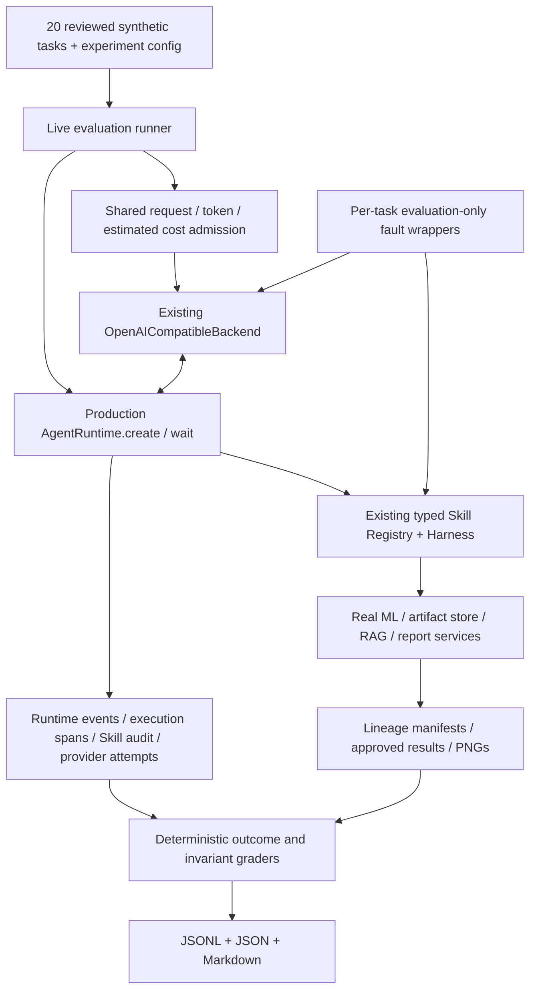

# Live LLM end-to-end evaluation

This evaluator exercises the existing SmartHealth Agent. It does not replace its
planner, tool implementations, retrieval or publication policy. **No live model
performance has been verified in this implementation.** Local infrastructure
tests use labeled scripted policies/HTTP mocks. The checked-in report is a dry
run, with no executed tasks and no external provider calls.

The [integration plan](LIVE_LLM_EVALUATION_PLAN.md) records the repository analysis
performed before implementation. Historical [system evaluation](evaluation.md)
and its scripted/live modes remain available and unchanged.

## Architecture



Canonical code is in `src/smarthealth/evaluation/live_llm/`. The benchmark is a
packaged resource at `src/smarthealth/resources/evaluation/live_llm_tasks.json`.
The CLI accepts reviewed task IDs, not arbitrary patient files or free-text
queries. CSV content is regenerated using the existing synthetic generator with
a recorded seed. Raw CSV rows never enter provider decision requests or exports.

Each task/repetition has a new Runtime, Registry, ArtifactStore, session and
ephemeral MemoryManager. Predictor and the verified retrieval index are loaded
once and reused; the local retriever retains its existing lock. The entry points
are exactly those used by FastAPI, but this is an **in-process runtime benchmark**,
not an HTTP/SSE deployment or throughput benchmark.

No expected answers, grader labels, failure rationale or success criteria are
sent to the model. The normal production prompt and permission-scoped decision
view remain unchanged. Optional temperature, output-token cap and provider seed
are additive adapter settings; application defaults retain their previous wire
format. Providers may reject unsupported parameters rather than silently ignore
them; use YAML `null` to omit temperature/seed where necessary.

## Benchmark design and coverage

| Category | Tasks | Observable checks |
|---|---:|---|
| Basic | 2 | Score-definition selection; risk-only plot parameter extraction |
| Multi-step workflow | 2 | Complete five-Skill analysis; analysis plus all three plots |
| RAG / citations | 3 | Grounded educational report; unsupported genetic claim; one empty retrieval and refinement |
| Tool / provider failures | 5 | Invalid CSV, transient backend error, malformed JSON, tool timeout, invalid tool output |
| Runtime safety | 5 | Unauthorized tool request, execution ceiling, invalid arguments, stale input version, duplicate execution |
| Ambiguous / unsupported | 3 | Missing upload, ambiguous query, unsupported booking request |

Each task defines its fixture, expected behavior, permitted/required Skills,
forbidden actions, success criteria, evaluation method, timeout and decision/tool
ceilings. Tasks allow different valid tool sequences. Complete analysis still
requires the existing five-Skill pipeline; a one-Skill final objective is not
invented for the benchmark. The reviewed corpus does not provide independently
labeled contradictory documents, so authentic conflicting-evidence resolution is
an explicit coverage gap.

The unsupported-evidence case requires no publication for the requested genetic
diagnosis. An unrelated educational report does not satisfy that task. This is a
narrow outcome check, not an automatic semantic evaluation of refusal quality.

Router-only clarification can pass a system case without any provider request.
Such cases are counted separately from live-exercised tasks. A network connection
attempt alone is insufficient: a valid provider-generated decision must be
received for live-exercised coverage.

## Setup and dry run

From a checkout with Python 3.12 and the project's dependencies:

```bash
python -m pip install -e '.[dev,ui]'
smarthealth-eval-live --dry-run --max-tasks 20 \
  --output evaluation/live_runs/first-dry-run
# Equivalent module entry, usable without reinstalling console scripts:
python -m smarthealth.evaluation.live_llm.runner --dry-run --max-tasks 20 \
  --output evaluation/live_runs/second-dry-run
```

Omitting `--live` defaults to dry-run. It validates the full packaged dataset and
configuration, expands selected repetitions and writes plans. It does **not**
load the ML bundle/index, read provider credentials, construct an HTTP client or
execute tasks. A dry-run success does not establish provider compatibility,
asset readiness, reasoning quality or task success.

Defaults select one task, one repetition and concurrency one. `--task ID` can be
repeated; `--max-tasks` caps the selected list before repetitions. Maximum supported
settings are 20 tasks, 10 repetitions and concurrency four, still subject to one
shared request/token/cost allowance. Use a new output directory for each run;
existing results are never overwritten.

## Providers and live execution

The supported interface is the existing **OpenAI-compatible Chat Completions
function-calling protocol**: one required tool call per decision, strict control
schemas, `max_completion_tokens`, and JSON usage counters when available.
Compatibility with a particular provider/model must be established with an
approved small live run; it has not been verified here. Native Anthropic, Gemini,
Responses API and arbitrary text-only servers are not implemented adapters.
HTTPS is required except for loopback HTTP. Credentials come only from
`HEALTH_LLM_API_KEY`; redirects and environment proxy discovery remain disabled.

After separately approving provider spending, configure your environment locally:

```bash
export HEALTH_AGENT_BACKEND=openai_compatible
export HEALTH_LLM_BASE_URL='https://YOUR_PROVIDER_API_ROOT/v1'
export HEALTH_LLM_MODEL='YOUR_TOOL_CALLING_MODEL'
# Set HEALTH_LLM_API_KEY through your local secret mechanism; never commit it.
export HEALTH_MODEL_DIR="$PWD/models_saved/lightgbm_v1.0"
```

The YAML example contains no credentials. Copy it to an ignored local file and
set your token prices and desired request/token/spending limits:

```bash
cp configs/live_llm.example.yaml configs/live_llm.local.yaml
smarthealth-eval-live --live --config configs/live_llm.local.yaml \
  --task score_definition --max-tasks 1 \
  --output evaluation/live_runs/approved-score-probe

# A separately approved real multi-step analysis:
smarthealth-eval-live --live --config configs/live_llm.local.yaml \
  --task csv_analysis --max-tasks 1 \
  --output evaluation/live_runs/approved-analysis
```

`--model` overrides the LLM model, not the physiological predictor. The latter is
configured by `HEALTH_MODEL_DIR`. Prepare a fresh trusted synthetic model with
`make data` and `make train` if needed; existing bundles are not overwritten.

RAG tasks additionally require `HEALTH_RAG_MODEL_DIR` and `HEALTH_RAG_INDEX_DIR`
pointing to prepared E5/Qdrant assets. Follow [RAG setup](rag_and_reports.md). The
runner never downloads models or silently substitutes embeddings. Missing RAG
paths skip those tasks; corrupt/incompatible configured assets fail setup. Index
corpus identity must match the reviewed packaged benchmark corpus. Do not run
this evaluator and the application against the same process-owned Qdrant path.

The `--live` switch authorizes requests for that invocation only. Installation,
CI, `make eval-dry` and normal tests cannot trigger paid evaluation. No live call
was made while implementing this feature.

## Budget, retries and failure injection

The experiment reserves the exact serialized request's byte length as a
conservative input-token estimate plus the configured output cap **before** each
provider attempt. Admission is atomic across tasks. Known usage releases unused
allowance; missing/partial usage, failed and cancelled requests retain uncertainty.
Any observed reservation overrun blocks further admission. Reservations include
injected transport failures even when no actual network call was sent, so
`admitted_requests` and actual network attempts are distinct counts.

Costs require both operator-supplied prices per million input/output tokens.
Without them, cost fields are `null`. Estimated known cost and retained uncertain
cost are separate; cached tokens, provider-specific reasoning accounting, discounts,
tokenizers and invoice corrections are not modeled. This is admission control,
not a guaranteed billing limit. Configure provider-side spending limits as well.
The report contains no invented prices or performance figures.

The production Runtime already retries transient decision errors at most once;
every attempt consumes its budgets. Malformed JSON becomes an error observation
and may recover on a later bounded decision. The evaluator does not add transport
retries or replay entire workflows, so it does not silently repeat completed
tool side effects after a provider failure.

Faults are one-shot and isolated to newly created evaluation objects:

- Backend 503 or malformed JSON: injected at the transport boundary; successful
  decisions still require actual provider output.
- Tool timeout: the real Registry timer expires; timed-out work cannot write late.
- Invalid output/arguments and stale input version: existing schema/artifact
  checks reject the injected fault.
- Empty retrieval: one real retrieval result is suppressed while preserving its
  corpus identity; subsequent refinement may recover.
- Duplicate execution: two actual calls consume two budgets and produce audit
  records. This exposes existing repeated effects, not exactly-once semantics.

The extra duplicate is excluded from model-only tool metrics, while physical
counts include it. Faults must both trigger and appear in observations/manifests
to count as detected. An unexercised injection is never counted as recovered.

Only `full_guard` is supported. Guard-off and retry-only variants would change
permissions, lineage and publication semantics, so they cannot form a fair
comparison without deeper runtime changes. The report explicitly marks comparison
results unavailable instead of inventing baselines.

## Metrics and outputs

| Measurement | Numerator / denominator or scope |
|---|---|
| Task completion | Deterministically successful tasks / attempted tasks, including infrastructure failures and partially executed budget-limited tasks |
| Conditional Agent quality | Passed / graded executed cases; setup errors/skips excluded and shown in coverage |
| Live-exercised completion | Passed / tasks with at least one valid real provider decision; router-only outcomes excluded |
| Tool selection | Permitted decoded model Skill calls / decoded model Skill calls; unknown malformed provider decisions are separately recorded as errors |
| Argument validity | Schema-valid original model arguments / decoded model Skill calls; injected mutations are separate |
| Workflow completion | Passed / graded workflow and RAG cases |
| Citations | Exact retrieved provenance matches / published citation pairs; complete-report citation rate also shown |
| Runtime violations | Runs violating checked state/budget/permission/publication invariants / graded runs; prevented attempts recorded separately |
| Recovery | Successful complete outcomes / triggered failure cases; safe termination shown separately |
| Latency | p50/p95 of executed in-process Runtime tasks, including agent failures; preparation and teardown excluded |
| Tokens and cost | Known reported usage plus usage coverage; retained unknown reservations separate; no price means unavailable cost |

Every ratio includes its denominator; an empty denominator is `null`, never 100%.
Citation identity does not establish semantic entailment or medical truth. No LLM
judge is used. First-token latency is unavailable for the nonstreaming provider;
SSE delivery is not token timing. Throughput remains unavailable rather than
being inferred from summed concurrent latencies.

Each experiment writes:

```text
results.jsonl          # One complete sanitized task record per finished repetition
summary.json           # Config/provenance, records, aggregates, budget and limitations
report.md              # Human-readable measurements, coverage and failures
artifacts/<task>_<rep>/*.png  # Actual plots referenced by published synthetic results
```

Records contain Runtime events/spans, Skill audits, provider attempt timing and
usage, decoded action metadata, artifact lineage/version/hash manifests and
validated final results. Raw prompts/responses, hidden reasoning, API keys, CSV
rows and intermediate dataframes are not exported. Image filenames map back to
artifact refs; original API URLs are ephemeral and cannot be used after fixture
cleanup. Completed rows are flushed to JSONL and summaries updated incrementally.
Interrupted evaluations retain completed evidence; they never automatically resume
or reissue model calls. Output directories use restrictive local permissions and
are ignored by Git unless intentionally reviewed for publication.

Provenance includes benchmark/config/prompt hashes, generator seed, model-bundle
manifest, actual corpus/index identity, Harness hashes, generation settings,
provider host/model, dependency versions and platform. UUIDs, timestamps, provider
nondeterminism and concurrent budget admission mean repeated runs need not be
byte-identical. Artifact content hashes are local serialization checks within the
recorded dependency environment, not portable dataset fingerprints.

## Verification

```bash
python -m pytest tests/test_live_*.py tests/test_agent_backends.py
make check
make package-check
```

Tests use existing real synthetic ML fixtures and real Registry/Runtime/report
services, with labeled scripted policies and mocked provider HTTP only for
infrastructure verification. They cover dataset/config contracts, budget races,
unknown usage, provider errors, failures, artifact export, citation tampering,
state consistency, metrics and reports. Wheel smoke also runs dry-run outside the
source checkout. See [verification record](LIVE_LLM_EVALUATION_VERIFICATION.md)
for executed checks and the checked-in dry-run report.

Exit codes: `0` for a valid dry-run or all selected live tasks passing; `1` for
failed/skipped live tasks; `2` for setup/configuration failure. A passing dry-run
or mock test suite must never be presented as a live LLM benchmark result.
