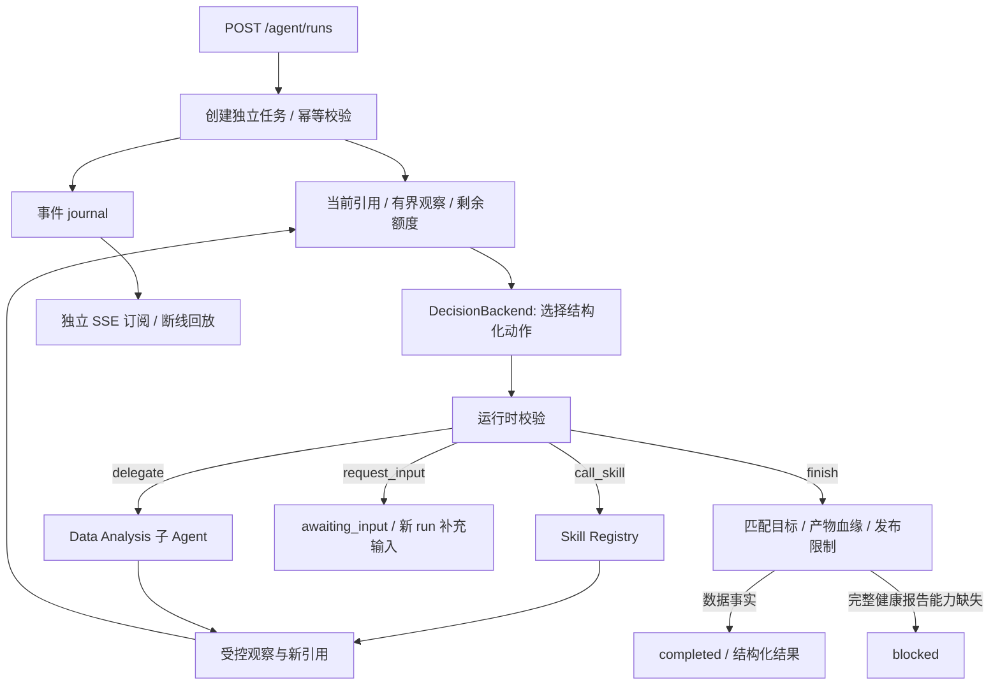

# Step 4 — ReAct Agent Loop

Step 5 已在执行循环前接入 [Agent Router](agent_router.md)。本文保留循环、后端与任务协议说明；当前 HTTP 接口自动选择 objective 和入口角色。

Step 6 已加入 [Memory Layer](memory_layer.md)。DecisionRequest 接收有界历史背景，RunSnapshot 新增 memory_status；分析 completed 与后续摘要写入状态分别呈现，runtime.wait() 等待记忆收尾。

Step 7 已接入 [YAML Harness](harness_engineering.md)。Runtime 与 Registry 共享启动时冻结的有效策略，RunSnapshot 和 trace 包含配置版本与哈希；最终事实经过来源和一致性检查，并附 publication 记录。历史 Step 4 示例仍保留原阶段输出，当前示例见 [Harness 结果](harness_example/run.json)。

Agent 每轮读取当前状态快照，选择一个结构化动作，执行后观察结果，再选择下一步。`AgentRuntime` 不预设六个 Skill 必须按某一串调用；它执行权限、依赖、输入版本、预算和发布检查。示例中的确定性策略是明确标记的测试 fixture，不是默认 Agent 的推理实现。

## 执行结构



本阶段可选角色为 `data_analysis` 和 `planner`。Planner 可以委派一次层级的 Data Analysis Agent；子 Agent 完成后向 Planner 提交观察，Planner 继续决策。子 Agent 不能提前结束或发布父任务，所有委派共享一个 run 的预算和输入版本。

`query` 是任务文本。HTTP 服务通过 Router 选择有效的 `objective` 和 `entry_agent`；客户端保留的同名字段只是兼容提示，不能降低路由识别出的任务范围。底层 `AgentRuntime(router=None)` 仅供独立执行器组件测试，应用工厂始终注入 Router。

| 动作 | 输入 | 运行时行为 |
|---|---|---|
| `call_skill` | 注册名称、严格参数 | 验证角色权限及当前 run 已观察到的引用，再通过 Registry 调用 |
| `delegate` | `agent=data_analysis`、有界子任务文本 | 仅 Planner、仅一层，结果回到父 Agent |
| `request_input` | `missing_upload` / `invalid_data` / `clarify_task` | 进入 awaiting_input；返回服务端固定提示 |
| `finish` | result_kind、result_ref | 只提交候选结果，必须经过发布检查 |
| `upgrade_workflow` | objective=data_analysis / health_report | 仅 simple 根 Agent 可升级一次；不重置 run、计数器或全局 deadline |

Think 在公开 trace 中表现为决策开始与选定的结构化动作。它不展示或保存模型的内部推理。Observe 只传递有限的派生事实、方向、错误码和临时引用；原始 CSV、窗口数组和全部逐窗分数不会进入下一轮 LLM 上下文。

## 发布范围

| objective | 当前结果 |
|---|---|
| `data_analysis` | 必须产生本 run 的 analysis_ref；要求图表时必须已有与该 analysis_ref 匹配的图表。服务端从真实产物重建 JSON 和固定摘要 |
| `score_definition` | 使用当前模型卡的固定分数说明，不接受 LLM 自由文本 |
| `health_report` | 当前 blocked，错误码 safety_unavailable；不能改成其他 result_kind 绕过目标 |

发布检查是基础的事实与来源约束，**不是 Step 8 的 Safety Verification Agent**。当前不会生成新的医学原因推断、诊断或治疗报告。模型不能通过 `finish` 参数插入自由文本、伪造分数或引用。

## 运行模式

默认 `HEALTH_AGENT_BACKEND=disabled`。`/predict`、`/analyze` 可以独立运行；创建 Agent 任务返回明确的 backend_unavailable。系统不会在缺少配置时悄悄使用脚本策略。

无需 LLM 的合成数据验证：

```bash
python -m examples.run_agent
```

默认使用真实 LightGBM、Planner 和六个 Skills，将样例写入 `data/generated/agent_example/`。本次实际结果：9 次脚本决策、6 次 Skill 调用、1 次委派、0 次外部 LLM 请求；样例见 [run.json](agent_example/run.json) 和 [trace.json](agent_example/trace.json)。这验证执行协议与领域工具，不证明真实 LLM 的规划效果。

真实 LLM 模式通过管理员环境配置启用：

```bash
export HEALTH_AGENT_BACKEND=openai_compatible
export HEALTH_LLM_BASE_URL='https://api.openai.com/v1'
export HEALTH_LLM_MODEL='your-tool-calling-model'
# 使用本机环境或密钥管理器设置 HEALTH_LLM_API_KEY。
# 数据 API 的 HEALTH_API_TOKEN 与 provider API key 是两个不同凭据。
uvicorn app.main:app --host 127.0.0.1 --port 8000 --workers 1 \
  --limit-concurrency 16 --no-access-log --log-config configs/logging.json
```

`.env.example` 仅作配置参考，应用不自动加载 `.env`。模型没有硬编码默认选择。provider 必须支持当前适配器发送的 Chat Completions function-calling 字段，包括 `tool_choice=required`、`parallel_tool_calls=false`、`max_completion_tokens` 和 `store=false`；不能假定所有标称兼容的网关都支持相同字段。协议参考 [官方 Function calling 文档](https://developers.openai.com/api/docs/guides/function-calling) 和 [Chat Completions API](https://developers.openai.com/api/reference/resources/chat/subresources/completions/methods/create)。

每次决策发送一个有界状态快照，要求返回恰好一个 function call；拒绝自由文本、refusal、多工具批量调用、重复 JSON key、无效参数及无效 token 用量。适配器不自动重试 HTTP。运行时仅对配置好的瞬态错误至多重试一次，重试计入额度；认证错误和 schema 错误不作网络重试。配置 URL 仅允许 HTTPS 或本机 HTTP，不跟随重定向；API 请求不能选择 provider URL 或模型路径。

启用真实 provider 后，query 与选定的派生分析摘要会发送给配置的 provider。原始传感器文件留在 Tool 服务中。当前项目未对任何外部 provider 的健康数据处理流程作认证；本阶段外部调用数为零。

## API 使用

| 路径 | 行为 |
|---|---|
| `POST /uploads` | 创建上传、session_id、input_version；可用 `?session_id=...` 为现有会话上传新版本 |
| `POST /agent/route` | 只读规则路由预览；检查输入引用，不调用 LLM、不创建任务 |
| `POST /agent/runs` | 接收任务；立即返回 202 和 run 快照 |
| `GET /agent/runs/{run_id}?session_id=...` | 查询状态、预算用量、已发布结果 |
| `GET /agent/runs/{run_id}/events?session_id=...` | SSE 进度与事件回放 |
| `GET /agent/runs/{run_id}/trace?session_id=...` | 受权限保护的保留事件 JSON |
| `POST /agent/runs/{run_id}/cancel?session_id=...` | 幂等取消；已结束任务保持原终态 |

所有数据、状态、事件与取消接口沿用现有认证。当前仍是单主体 API；服务端身份固定为已认证的开发主体，session_id 不代替用户认证。Agent 请求 JSON 在解析前限制为 32 KiB；单任务最多一个上传引用。

配置真实后端后，可运行下列客户端。它读取现有 API bearer 环境变量，不会将该 token 传给 LLM：

```python
import os
from pathlib import Path
import httpx

token = os.getenv("HEALTH_API_TOKEN")
headers = {"Authorization": f"Bearer {token}"} if token else {}
with httpx.Client(base_url="http://127.0.0.1:8000", headers=headers, timeout=240) as client:
    upload = client.post("/uploads", files={
        "file": ("demo.csv", Path("data/sample/demo.csv").read_bytes())
    })
    upload.raise_for_status()
    uploaded = upload.json()
    response = client.post("/agent/runs", headers={"Idempotency-Key": uploaded["upload_ref"]}, json={
        "query": "分析合成 CSV 数据，展示模型贡献并生成图表。",
        "session_id": uploaded["session_id"],
        "input_version": uploaded["input_version"],
        "upload_refs": [uploaded["upload_ref"]],
        "objective": "data_analysis",
        "entry_agent": "planner",
        "include_visualizations": True
    })
    response.raise_for_status()
    run = response.json()
    with client.stream("GET", run["events_url"]) as stream:
        stream.raise_for_status()
        for line in stream.iter_lines():
            print(line)
    result = client.get(f"/agent/runs/{run['run_id']}", params={"session_id": run["session_id"]})
    result.raise_for_status()
    print(result.json())
```

成功结果具有 `status=completed`、`result_available=true` 和 `final_result`；后者包含版本化数据分析 JSON。等待输入、失败、取消或被阻止时，检查 status、error_code、message，不将 HTTP 200 快照误认为任务成功。

`Idempotency-Key` 在同一用户、同一请求内容范围内复用已有 run；内容变化返回 409。相同会话同时只允许一个活动 run，其他请求返回 session_busy。awaiting_input 是当前任务的停止状态；补充输入需创建带 parent_run_id 的新 run，且父任务必须属于同一用户和会话。上传新文件创建新的 input_version，旧输入不会覆盖新 run。

幂等表目前仅在当前进程与任务保留期内有效；重启后不会恢复旧 key 映射，也不会自动恢复 LLM 调用。可靠跨重启提交与分布式任务执行属于后续存储/调度工作。

## SSE 与审计

事件 ID 在单个 run 内单调递增。客户端断线只结束订阅，不取消 Agent；用 `Last-Event-ID: <最后已处理编号>` 重连，服务只发送其后的事件。游标非法或超前返回 422；早于保留窗口返回 409 replay_unavailable，并可通过快照查看终态。终态事件发送完后连接关闭，连接中的 keepalive 不占事件 ID。

当前 SSE 是执行进度与状态流，不是 LLM 报告 token 流。经医学审核后的报告流属于 Step 8。HTTP 日志中的 latency_scope=response_headers 表示响应头延迟，不能作为完整 Agent 任务耗时或首个报告 token 延迟。

浏览器原生 EventSource 不能设置当前 bearer header；前端接入应使用可携带 Authorization 的 fetch streaming。当前阶段提供 Python 客户端与真实 HTTP 测试，完整 Streamlit 在后续阶段集成。

默认 journal 位于 `logs/agent_runs/{run_id}.jsonl`，可用 HEALTH_AGENT_TRACE_DIR 配置。目录和文件权限分别为 0700/0600；写入成功后才发布内存事件，IO 失败会阻止结果发布。记录 owner/session、输入版本、request_id、backend_mode、decision_model、动作、引用、Skill 版本、耗时和用量；不记录原始 query、子任务文本、provider 内容、原始数据或完整 final_result。

每个 run 的内存事件上限 512、journal 上限 4 MiB，任务上限 128，审计保留上限 7 天；达到容量时只淘汰最旧终态任务，活动任务不会被淘汰。已发布结果在内存保留一小时，超过时 result_available=false。临时数据依然受 Artifact Store 的 TTL 和容量约束。

重启恢复只读取受控 journal。未结束任务变为 failed/process_restarted；历史已完成任务保留其历史终态，但结果不恢复。部分写入的最后一行会截断修复；完整记录损坏时拒绝恢复，不把损坏审计当成有效证据。没有多进程文件锁或分布式队列，因此当前服务必须使用 `--workers 1`。

## 预算与验证边界

默认全 run 最多 32 次决策、32 次 LLM 请求、18 次 Skill 调用、8 次 Data Analysis Skill 调用、8 次一层委派；总 deadline 180 秒，单次决策最多 30 秒。所有子 Agent 共享全局额度；非法动作消耗决策额度，只有实际进入 Registry 执行的调用消耗 Skill 额度。

Step 5 的 simple 路径进一步限制为最多 4 次决策、4 次 LLM 请求、30 秒，不提供数据 Skill 或委派。升级后使用 complex 配额，已消耗次数继续累计，全局 deadline 仍从创建时计算。更严格的自定义 AgentLimits 始终生效。

provider 状态快照上限 128 KiB、响应上限 64 KiB、单次输出上限 2,048 token。额外的 65,536 token 限制依据 provider 已返回的用量，在收到结果后检查；缺失用量标记不可用。它不是能预知失败请求费用的硬账单上限，HTTP 请求次数和 deadline 独立限制。Step 7 已将执行上限统一接入 YAML Harness，系统级评估留到 Step 9。

同步 Skill 超时后保留线程槽位，直到底层计算真正退出；取消后的上下文拒绝迟到写入，runtime 不接纳迟到观察。线程和本地 journal 不是分布式 worker 隔离方案，当前项目尚无生产负载或临床验证结论。

执行测试：

```bash
python -m pytest
```

真实 SSE 断线/重连复验需要两个终端。测试 fixture 只用于本机合成数据，固定测试 bearer 为 `local-sse-test`，不能用作生产启动入口：

```bash
# 终端一
uvicorn examples.agent_http_fixture:app --host 127.0.0.1 --port 8765 \
  --workers 1 --limit-concurrency 16 --no-access-log --log-config configs/logging.json
# 终端二
python -m examples.check_agent_http
```

测试后关闭 fixture 服务。循环建立时的验证见 [Step 4 验证记录](step4_verification.md)，当前 Router 集成回归见 [Step 5 验证记录](step5_verification.md)。
