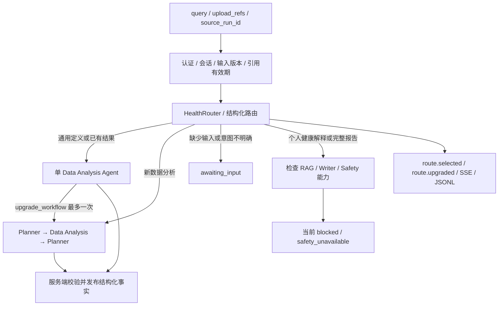

# Step 5 — Agent Router

Router 把任务意图转换为可执行的范围约束，ReAct Runtime 再决定范围内的下一步动作。`app/agents/router.py` 是纯规则模块，无文件读写、模型调用或会话缓存；执行器提供已经验证的上传与结果可用性。它不会因为文本声称“已上传”或“使用 simple”而授予权限。



## 选择规则

| 请求 | workflow_type | 有效目标 / 行为 |
|---|---|---|
| “解释risk score” | simple | 单 Agent 请求模型卡中的固定定义 |
| “显示上次结果和已有图表” | simple | 只展示 source_run_id 指向的已验证结果；未提供来源则 awaiting_input |
| “分析CSV数据并绘制图表” | complex | Planner 委派数据分析；图表成为必须完成的产物 |
| “这个用户为什么风险较高” | complex | health_report，要求检索、写作与安全审核；当前阻止发布 |
| “上传数据并生成完整健康分析报告” | complex | health_report，当前阻止发布 |
| “分析CSV数据”，实际没有上传 | complex | awaiting_input / missing_upload |
| “继续”“score”等不能确定目标的文本 | complex | awaiting_input / clarify_task |

规则先进行 Unicode NFKC、大小写和空白归一化。Simple 使用完整语句匹配，不采用“包含 risk score 就走简单路径”的规则。报告、医学内容和个人风险原因具有较高优先级。追加指令不能扩展 simple 的发布范围。中英文混排 CSV 和显式图表请求有独立测试。

此版本对歧义直接请求补充输入，**没有额外的 LLM 路由分类调用**。这使路由可复现、无网络成本，也会让未覆盖的同义表达进入澄清或更保守的路径。后续可在共享预算内增加至多一次结构化分类，但它仍不能放宽 Skill 权限或发布检查。路由分类不等于医学语义安全审核。

`objective` 和 `entry_agent` 为旧客户端保留。实际入口始终由 Router 决定；例如 CSV 分析请求即使传入 `objective=score_definition, entry_agent=data_analysis`，也进入 Planner。`objective=health_report` 可以提高要求，不能用其他 hint 降低已识别的医疗任务范围。

## 接口与输出

`POST /agent/route` 与 `POST /agent/runs` 接收同一请求 schema。预览只检查请求和引用，不创建任务、不写 trace、不需要启用 LLM 后端。两者都要求现有 API 认证，JSON body 在解析前最多 32 KiB。正式任务仍要求显式配置决策后端，缺省返回 503 backend_unavailable。

```bash
curl --fail-with-body http://127.0.0.1:8000/agent/route \
  -H 'Content-Type: application/json' \
  -d '{"query":"解释risk score","session_id":"demo-session","input_version":"v1"}'
```

如果设置了 `HEALTH_API_TOKEN`，客户端还需发送相应的 `Authorization: Bearer ...`。

```json
{
  "workflow_type": "simple",
  "reason_code": "score_definition",
  "objective": "score_definition",
  "entry_agent": "data_analysis",
  "required_capabilities": ["model_card"],
  "needs_input": null,
  "router_version": "1.0"
}
```

正式任务的返回快照新增 `route`、`initial_workflow_type`、`workflow_upgrades` 和 `source_run_id`。`route` 是当前有效决策，升级后更新。预览没有保留或锁定引用，正式提交与最终发布仍会重新校验；过期来源不会因为曾通过预览就继续有效。

新数据分析流程仍为先 `POST /uploads`，再把返回的 session_id、input_version、upload_ref 放入 `POST /agent/runs`。不接受用户本地 file_path。

## 已验证结果复用

```json
{
  "query": "显示上次结果和已有图表",
  "session_id": "由上传接口返回的会话标识",
  "input_version": "与原分析一致的数据版本",
  "source_run_id": "由原分析返回的任务标识"
}
```

以上三个标识应替换为真实返回值。来源必须属于同一 owner、session 和 input_version，处于 completed 状态，保留完整 data_analysis 结果，且 analysis → prediction → features → windows → dataset → upload 与图表引用全部仍有效。若同时提供 upload_refs，还必须与原分析的上传一致。创建、预览与最终显示时都检查来源。

这条展示路径仅复用进程内保留的已验证数据分析，不推断“最近一次”，不查询跨会话结果。后续已实现的 [Step 6 Memory](memory_layer.md) 提供摘要背景，但不能恢复可发布的完整 analysis 或替代这条路径的引用校验。`parent_run_id` 用于补充 awaiting_input 任务的输入；`source_run_id` 用于展示已有结果，两者用途不同。

Simple 不重新调用预测或绘图，不增加健康解释。要求已有图表而原结果没有图表时，返回 `source_visualization_unavailable`；应另发新数据分析任务。返回保留原始 analysis.request_id 与内容，在外层附加 source_run_id，避免把历史分数误当作新预测。重复展示沿用原结果到期时间，不延长其保留期。来源在决策等待期间过期或被移除时，不发布结果并要求补充有效输入。

## 一次升级与执行约束

Simple Agent 仅收到 `finish`、`request_input` 和 `upgrade_workflow` 控制函数。`upgrade_workflow` 采用严格 schema，只能选择 data_analysis 或 health_report。运行时拒绝 simple 直接调用 Skill 或委派；错误动作仍消耗决策额度。

升级事件成功写入后才切换到 Planner；same run_id、输入上下文、用量、全局 deadline 和取消状态保留。Complex 不提供升级函数，也不能降回 simple；脚本后端即使强行返回第二次升级也会被拒绝。升级若缺少上传则等待输入，升级到健康报告仍经过能力检查。

| 默认约束 | simple | complex |
|---|---:|---:|
| 最大决策次数 | 4 | 32，包含升级前已用次数 |
| 最大 LLM 请求数 | 4 | 32，包含升级前请求和重试 |
| 数据 Skill 调用 | 0 | 全 run 18；Data Analysis 8 |
| deadline | 创建后 30 秒 | 创建后 180 秒 |

更严格的 AgentLimits 取更小值。路由本身不调用 LLM，Token 限制与 ReAct 的既有用量检查保持一致。Simple 的两类操作不需要新增 Skill，所以当前数据 Skill 数为零；后续 YAML 配置归入 Step 7。

## 审计与验证

`route.selected` 和 `route.upgraded` 记录完整的结构化路由与升级次数，不记录原始 query、自由文本理由或生理测量值。只允许固定的原因、能力和角色枚举。Journal 在写入前验证完整路由与单向状态变化；进程重启保留初始和当前路由、目标、入口角色及次数，不恢复原始输入或报告。旧版无路由字段的 journal 仍可读取。

```bash
python -m examples.run_routing
python -m pytest
```

示例使用明确标记的脚本 DecisionBackend 和真实 LightGBM，输出六种场景的 runs.json 与 trace.json 到 `data/generated/router_example/`。示例完成后关闭临时 Artifact Store，因此 JSON 中的 PNG URL 只说明接口结构，不是持久化图片服务。生产任务的图表应在服务运行且引用有效时下载。

实际样例见 [runs.json](router_example/runs.json)、[trace.json](router_example/trace.json)，验证记录见 [Step 5 验证](step5_verification.md)。这验证 Router 与执行器的工程行为；真实 LLM 规划表现和整个 Agent 的系统评估留到后续 Evaluation 阶段。
