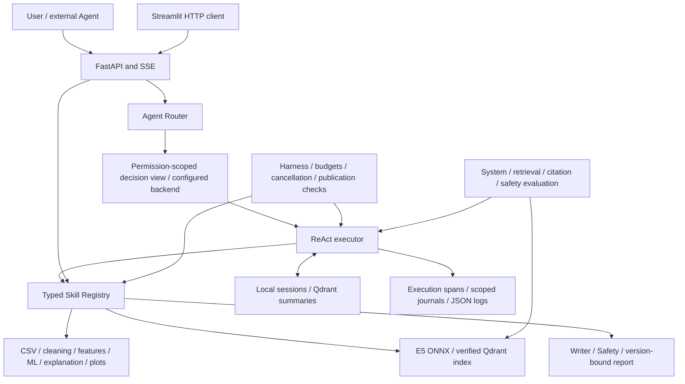

# Architecture and package boundaries

SmartHealth separates physiological computation from Agent decision making. The
`0.2.0` refactor moves the existing implementation into `src/smarthealth`; it does
not replace its ML pipeline, report policy, HTTP contracts or evaluation labels.

## Agent layer

`agents/router.py` chooses the simple or complex path using the existing routing
policy. `agents/planner.py` constructs a typed decision request from authorized
references, bounded observations, current memory and remaining budgets. It is
used for the Planner and specialist roles; it does not invent an independent
planning model. `agents/backends.py` supplies the real OpenAI-compatible adapter,
an explicitly disabled backend, and a clearly labeled scripted test adapter.

`agents/executor.py` owns the existing ReAct loop: request a decision, validate the
action, execute or delegate, observe, and decide again. The five configured roles
are Planner, Data Analysis, RAG, Report Writer and Safety Verification. Roles run
inside one coordinator; they are not five separate services. Retries, token usage,
role permissions and report publication checks remain enforced by the runtime.

## Skill layer

`skills/base_skill.py` defines `BaseSkill`, `SkillModel` and `SkillResult`.
`skills/validation.py` applies strict Pydantic input/output validation.
`skills/registry.py` freezes the configured catalogue, exports tool schemas,
enforces allowlists, reserves atomic budgets and holds worker slots until work
actually exits, including after timeouts. All nine existing Skills are retained.

Skill adapters delegate computation to `services/analysis_service.py`, shared
`pipeline/` transformations, `models/`, `explain/`, `visualization/`, `retrieval/`
and `reports/`. The API and Agent use the same Skill implementations. The
RandomForest/LightGBM bundle is loaded once per application lifespan.

## Runtime layer

- `runtime/state.py`: the authoritative `RunState`, including bounded observations,
  counters, references, status, ephemeral result data and per-run execution spans.
- `runtime/context.py` and `runtime/guard.py`: server-owned identity, atomic call
  budgets, deadlines and cooperative cancellation. A timed-out thread is not
  assumed to have stopped.
- `runtime/harness/`: validated YAML policy, role constraints, lineage checks and
  deterministic report publication controls. Business safety rules remain here.
- `runtime/events.py`: bounded progress events, SSE replay and privacy-safe local
  journals. Restart recovery marks interrupted work; it does not replay paid calls.
- `runtime/memory/`: recent turns, leases, TTLs and Qdrant summary persistence.
  Raw CSV and complete conversations are not long-term memory payloads.
- `runtime/execution_trace.py`, `runtime/trace.py`, `runtime/logging.py`: task/role
  spans, Skill audit events and JSON formatting.

Execution logs include `task_id` (the existing `run_id`), `agent_name`,
`skill_name`, `start_time`, `end_time`, `status`, `error_code` and a safe
`error_message`. A task/role span has `skill_name: null`; a direct Tool API call
uses `agent_name: tool_api`. Start events have no end time until execution ends.
The task duration and each nested role duration are distinct. Skill durations
include queue waiting. IDs correlate these logs with the existing HTTP request
and SSE events. Raw prompts, provider responses, CSV values and secrets are not
added to the trace. Role span snapshots are bounded and in-process; existing
durable journals remain the restart/replay source of truth. Production log
collection/export is an operator responsibility, not an implemented tracing SaaS.

## Retrieval layer

`retrieval/embeddings.py` retains the `Embedder` protocol and real, pinned E5 ONNX
implementation. Corpus chunking, provenance, model-cache verification and index
fingerprints are unchanged. `retrieval/vector_store.py` names the database
operations required by the existing `QdrantClient`; `retrieval/retrieval.py`
validates the persisted index and rechecks returned payloads before publishing
evidence. This interface does not imply a new remote database implementation.

## Configuration and resources

`config/settings.py` reads one validated environment snapshot per application
lifespan. `create_app(settings=...)` allows explicit injection; factories still
support their existing test dependencies. Secrets use `SecretStr` and are
excluded from settings serialization. Settings are not cached at import time and
`.env` files are not loaded automatically.

Default YAML profiles, logging configuration, curated knowledge, evaluation
cases and a synthetic CSV ship in the wheel under `resources/`. Root `configs/`
and `knowledge/` remain operator examples; a regression test detects accidental
drift between those examples and packaged defaults. Mutable files default to
`HEALTH_HOME` (the current working directory if unset), with per-path overrides.
Nothing writes models, logs or databases into `site-packages`.

## Evaluation layer

`evaluation/` inside the package contains the real runner, cases and metrics.
The root `evaluation/` directory retains recorded results and legacy entry points.
Scripted/live provenance, denominator definitions, request budgets, corpus hashes
and the known semantic-review failure are preserved. See [evaluation.md](evaluation.md)
for current evidence and future benchmark design.

`evaluation/live_llm/` adds an independent opt-in runner using the same production
Runtime entry points. It owns only experiment configuration, shared request/token/
estimated-cost admission, isolated one-shot faults, safe trace/artifact collection
and deterministic grading. The existing provider gains optional generation
controls without changing its default behavior. See the
[integration plan](LIVE_LLM_EVALUATION_PLAN.md) and
[live evaluation guide](LIVE_LLM_EVALUATION.md). No live benchmark results are
claimed from infrastructure tests or the checked-in dry-run.

## Migration and compatibility

| Previous source | Canonical package |
|---|---|
| `app/main.py`, `app/api/` | `smarthealth.api.application`, `smarthealth.api` |
| `app/agents/runtime.py` | `smarthealth.agents.executor` |
| `app/agents/` decision/router modules | `smarthealth.agents` |
| `app/core/`, Agent events/limits | `smarthealth.runtime` |
| `app/harness/`, `app/memory/` | `smarthealth.runtime.harness`, `smarthealth.runtime.memory` |
| `app/rag/` | `smarthealth.retrieval` |
| `skills/` | `smarthealth.skills` |
| `train.py`, `generate_demo_data.py`, index script | `smarthealth.cli` |
| `frontend/`, `evaluation/`, `examples/` Python modules | corresponding `smarthealth` subpackages |

Root Python files are compatibility entry points for existing source-checkout
commands and imports. Imported modules share identity with canonical modules, so
exception types and monkeypatches do not diverge. Wheels expose only `smarthealth`
and documented console scripts. New integrations should use the canonical names.

Single-process state, one development identity, source-specific Qdrant types in
the database protocol, unvalidated live-model quality and container runtime
verification remain explicit technical debt. See [portfolio_checklist.md](portfolio_checklist.md).
