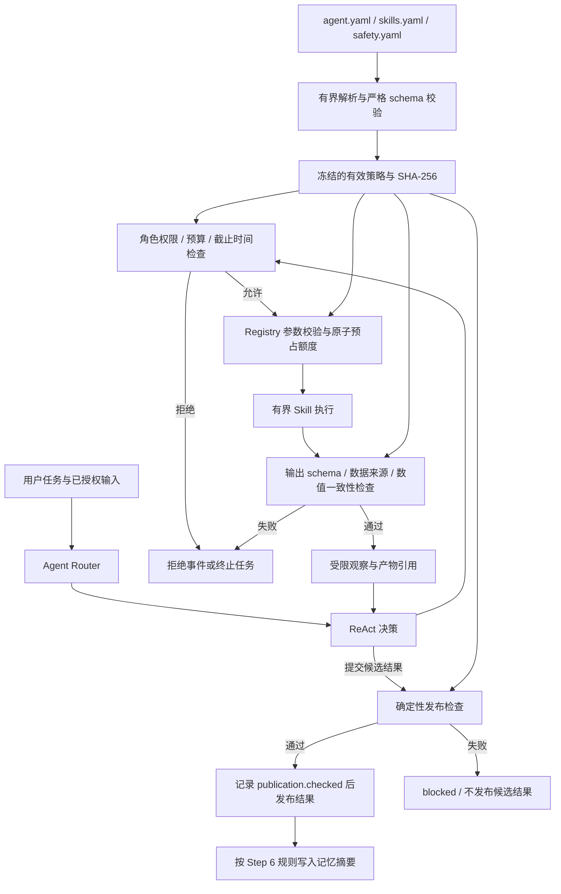

**Step 7：Harness Engineering**

本阶段将 Agent 的权限、预算、Skill 执行检查和结果发布检查组织为可验证的运行策略。LLM 提出结构化动作；服务端依据启动时加载的策略决定是否执行。配置只控制已经实现的能力，不能通过增加一个 YAML 名称创建新的 Agent 或绕过结果审核。

实现入口是 [配置加载器](../app/harness/config.py)、[HarnessValidator](../app/harness/harness_validator.py)、[AgentRuntime](../app/agents/runtime.py) 和 [SkillRegistry](../skills/registry.py)。HTTP 应用在启动时给 Runtime 与 Registry 绑定同一份有效策略。



图中的检查有不同职责：Router 选择任务路径，Runtime 执行角色权限与运行预算，Registry 检查单次调用，发布检查核对最终事实。它们共享策略，但不相互替代。`model_card` 与 `verified_result_read` 是 Router 使用的能力标签，分别由模型说明和已授权结果展示实现，无须伪装成 Registry 中的 Skill。

配置分为三个文件：

| 文件 | 主要字段 | 当前行为 |
|---|---|---|
| [agent.yaml](../configs/agent.yaml) | `schema_version`、`version`、`name`、`limits`、`roles` | 设置运行上限，以及 Planner、Data Analysis 的工具与委派权限 |
| [skills.yaml](../configs/skills.yaml) | `schema_version`、`version`、`skills[].name/enabled/version/timeout_seconds` | 显式声明全部六个已实现 Skill，决定是否启用、匹配版本与执行时限 |
| [safety.yaml](../configs/safety.yaml) | `publication_policy`、`medical_report_enabled`、`safety_rules` | 固定事实发布策略及不可关闭的最低要求 |

三个文件的 `schema_version` 当前均为字符串 `"1.0"`，策略发布版本 `version` 必须一致。Skill 条目自身的 `version` 必须匹配已安装 Skill 的实现版本，即使该条目已禁用，也需要完整声明。未知字段、未知角色或 Skill、重复权限、缺失权限列表、错误类型和不一致版本都会使启动失败。

例如，Planner 的默认权限为：

```yaml
roles:
  planner:
    allowed_skills: []
    allowed_delegates: [data_analysis]
```

显式 `[]` 表示没有授权。删除权限字段不会恢复默认权限。Planner 只能做一层委派，不能直接执行数据 Skill；Data Analysis 不能委派其他 Agent。配置可以收紧这些权限，不能扩展代码规定的角色职责。当前也不能在配置中启用尚未实现的 RAG、Writer 或 Safety Agent。

禁用 Skill 时保留其条目并设置 `enabled: false`。它会从可见工具目录中移除，Registry 也会拒绝执行。因此，即使模型仍提议调用被禁用的工具，或者通过 `/predict`、`/analyze` 的底层 Tool 入口触发调用，也不能绕过全局禁用。Agent 可执行工具取“角色权限列表 ∩ 已启用 Skill”；单纯修改提示词或工具列表不构成执行授权。

PyYAML 已作为运行依赖加入 [pyproject.toml](../pyproject.toml)。在项目根目录安装和启动：

```bash
python -m pip install -e '.[dev]'
python -m uvicorn app.main:app --host 127.0.0.1 --port 8000
```

默认配置目录根据模块位置解析为项目内的 `configs/`，不依赖启动时的工作目录。部署时可显式选择包含三个文件的目录：

```bash
export HEALTH_HARNESS_CONFIG_DIR=/absolute/path/to/configs
python -m uvicorn app.main:app --host 127.0.0.1 --port 8000
```

该环境变量指定的目录无效时，服务不会回退到默认策略。[.env.example](../.env.example) 提供了变量示例；使用 shell 导出变量或由部署环境注入。YAML 每个文件最多 64 KiB，采用安全解析器，拒绝别名、合并键、重复键、非字符串映射键、多个文档和超过 16 层的嵌套。解析及 schema 校验在模型、执行池和记忆存储初始化之前完成，错误消息不回显配置原文。

加载后的嵌套配置模型冻结，权限和 Skill 集合使用元组保存。运行中修改 YAML 不会改变已有实例；需要重启应用才能加载新策略。Registry 绑定策略后冻结注册目录，也不能改绑不同的策略快照。通用 Registry 的独立单元测试可以不绑定 Harness；HTTP 应用始终绑定，客户端没有关闭开关。

有效策略经过规范化 JSON 序列化，再计算 SHA-256，作为 `harness_hash`；`harness_version` 标识对应策略发布版本。相同有效配置内容的 YAML 排版或注释变化不会改变哈希。通过应用构造参数提供的 `AgentLimits` 只会逐项收紧 YAML 上限，合并后的有效配置参与哈希计算。部署配置与代码内更严格的约束共同生效。

默认 Agent 预算如下，完整字段和允许范围见 [AgentLimits](../app/agents/limits.py)：

| 约束 | 默认值 | 执行范围 |
|---|---:|---|
| `max_tool_calls` | 18 | 整个 run 的 Skill 调用总数 |
| `max_data_tool_calls` | 8 | Data Analysis 的累计 Skill 调用数，跨委派累计 |
| `max_decisions` | 32 | 整个 run 的结构化决策请求次数 |
| `max_llm_requests` | 32 | live 后端的 LLM 请求次数，含瞬态错误重试 |
| `max_delegations` | 8 | Planner 的累计委派次数 |
| `max_total_tokens` | 65,536 | 后端已上报的输入与输出 token 总数 |
| `run_timeout_seconds` | 180 秒 | 整个 run 的最长执行时间 |
| `decision_timeout_seconds` | 30 秒 | 单次决策请求的最长等待时间 |
| `simple_max_decisions` / `simple_max_llm_requests` | 4 / 4 | simple 路径的额外上限，同时受全局上限约束 |
| `simple_timeout_seconds` | 30 秒 | simple 路径从任务开始计时的额外截止时间 |

simple 当前只发布指标定义或展示已授权结果，不执行新数据 Skill，也不委派 Planner。需要分析新数据时，必须先完成一次受控升级。升级继续使用原 run 的身份、已消耗额度和起始时间；升级后的 complex 上限不会把已使用的次数清零。非法动作仍消耗决策次数；实际开始执行的 Skill 在执行槽位内原子预占工具额度，后续失败与重试也计入额度。

后端未提供 token 用量时，系统将用量标记为不可完整统计，而不会把未知用量当成零。请求次数、决策次数、工具次数及截止时间仍独立执行。脚本测试后端不计为外部 LLM 请求。

并发与保留配置的默认值为 `max_active_runs=8`、`max_retained_runs=128`、`max_observations=32`、结果保留 1 小时、任务事件保留 7 天。以上是当前实现的资源上限，不代表吞吐或延迟承诺。实际配置可在 [agent.yaml](../configs/agent.yaml) 的 `limits` 中补充对应字段。

Registry 执行前确认上下文仍有效，检查工具权限、全局启用状态、实现版本和输入 schema。每次 Skill 的截止时间取运行上下文、代码内执行时限和 YAML `timeout_seconds` 的更严格限制。默认各数据 Skill 为 30 秒，绘图为 45 秒。同步推理与绘图进入有界执行池；调用方超时后，底层线程结束前仍占用执行槽位，迟到结果不能进入当前任务观察。

执行后的检查既验证输出结构，也对照服务端保存的产物：

| Skill | 检查内容 |
|---|---|
| CSV Analysis | 数据集与上传的来源关系，实际列名、行数及保存的数据质量报告 |
| Signal Processing | 窗口集合与数据集的来源关系，窗口数、清洗报告及警告 |
| Feature Extraction | 特征集合与窗口集合的来源关系，特征名、窗口数及特征协议版本 |
| Anomaly Prediction | 预测与特征集合的来源关系，保存的预测事实、模型说明及窗口数 |
| Feature Explanation | 解释与预测的来源关系，保存的解释内容，以及非空的局部证据和限制说明 |
| Visualization | 图表类型覆盖请求，每个图片引用绑定当前分析，图片类型、MIME 与受控 URL 一致 |

来源关系通过 [ArtifactStore](../app/core/artifacts.py) 的服务端元数据验证，并继续检查用户、会话、输入版本和有效期。模型输出中的引用字符串不能自行证明来源。预测检查还验证窗口索引连续、最高分窗口和聚合分数一致、异常比例正确、标签与模型阈值一致、风险等级与模型风险阈值一致，以及合成数据的模型范围和分数语义。通过检查后，结果才能进入 Agent 的受限观察或 Tool API 响应。

最终发布由 `validate_publication()` 执行确定性检查。指标定义必须匹配当前模型说明生成的固定内容；分析结果必须匹配服务端保存的预测、解释和清洗报告，使用当前会话及输入版本，图表也必须属于该分析。来自 LLM 的自由文本不能替换这些事实。复用已有结果时，发布信息在当前策略下重新构建，不沿用旧结果内的审核标记。

Agent 通过检查后的 `final_result` 增加 `publication` 字段，包含当前策略、版本和哈希、分析引用或模型说明来源、不确定性说明，以及高分结果的固定后续建议。高分建议要求先核对输入协议、数据完整性和采集质量，再复测分析；不会把合成模型分数转写成诊疗结论。`medical_review` 明确为 `"not_performed"`。这部分是 Agent 结果的发布记录；原 `/predict` 与 `/analyze` 保持各自 Tool 响应契约，并共享 Registry 层的执行检查。

`safety.yaml` 中的证据、禁止确定诊断、高分建议、不确定性和当前输入要求必须为真正的布尔 `true`，`medical_report_enabled` 必须为 `false`。当前发布策略只接受有来源的固定事实，尚未实现对任意医学主张及引用支持关系的语义审查。`health_report` 路由仍进入 `blocked`，错误为 `safety_unavailable`；修改配置不能启用尚不存在的医疗报告能力。

发布检查失败时会记录 `publication.rejected`，候选结果不写入 `final_result`，任务进入 `blocked`。发布成功先记录 `publication.checked`，随后提交 `completed` 和最终结果，再按 Step 6 的规则处理记忆摘要。失败或阻止的任务保留终态交互摘要，但不会被写成一次成功的长期分析。记忆删除后的租约失效、用户隔离和迟到结果处理继续由 [Memory Layer](./memory_layer.md) 的机制负责。

审计元数据增加 `harness.loaded`、`harness_version` 和 `harness_hash`，Skill trace 与任务快照也可关联策略。事件仍只允许受控字段，不保存 YAML 原文、用户查询、原始传感器数据或被拒绝的候选正文。SSE 使用同一组已授权事件提供进度和重放；配置检查没有引入未审核文本流。

旧版本日志缺少 Harness 字段时仍可恢复，快照中的策略版本与哈希保持为空；新日志要求两个字段成对存在。恢复只提供原有安全元数据与执行记录，进程重启不会恢复原始输入、结果或模型执行，也不会把当前配置哈希补写成旧任务当时使用的策略。

当前部署仍是单进程 FastAPI：任务、调用额度、暂存产物与短期会话状态由该进程管理。长期摘要向量存储沿用 Step 6 实现。Harness 没有增加跨进程任务调度、分布式预算或自动恢复执行能力；需要扩容时应继续按整体架构补充这些基础设施。

后续 Step 8 增加知识文档索引、RAG 检索及可追溯证据，并完成需要证据与语义核验的报告路径；在实际审核能力就绪前，现有医疗报告发布限制保持生效。Step 9 增加系统级 Evaluation，衡量任务完成、工具执行、路由、检索、引用、安全和系统性能，并按项目阶段计划补齐展示与部署验收。当前文档描述已实现的 Harness，不将这些后续能力计作完成。
