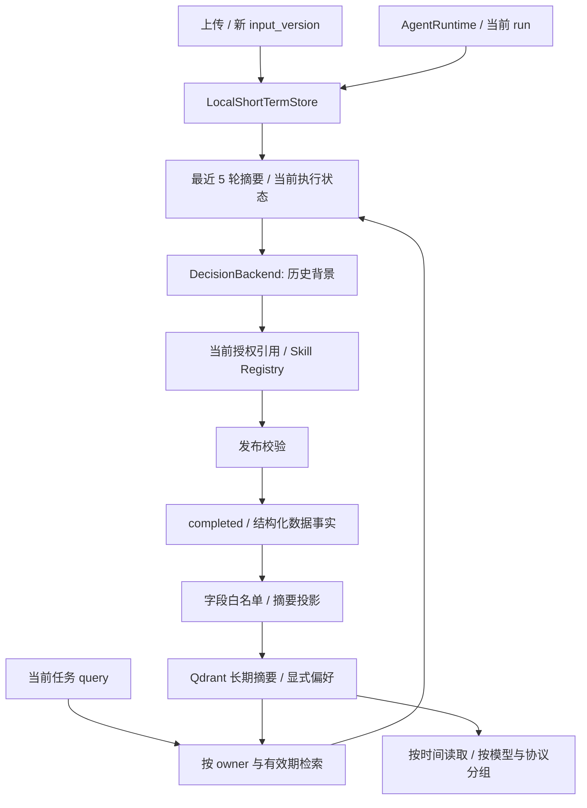

# Step 6 — Memory Layer

Memory 为后续决策提供受约束的历史上下文，不改变当前数据的校验与发布流程。`app/memory/memory_manager.py` 协调本地会话存储、长期摘要投影和 Qdrant；Agent 通过结构化 DecisionRequest.memory 使用这些信息，不能直接选择存储用户或覆盖查询过滤条件。



## 两层存储

| 层 | 保存内容 | 默认限制 |
|---|---|---|
| Short-term | session/input_version、当前上传引用、已完成分析的 run 引用与预测摘要、当前执行状态与计数、最近 5 个完整交互的结构化摘要 | 128 个会话；空闲 1 小时过期；读取和轮询不延长有效期 |
| Long-term | 已发布的新分析摘要、显式语言/详细程度偏好、分析时间、模型与评分协议 | 每个 owner 最多 512 条（包括偏好）；30 天有效；支持删除 |
| Artifact Store，独立 | 临时 CSV、窗口、特征、局部解释与图表 | 保持已有 TTL、容量和引用权限检查 |
| Trace，独立 | 事件、引用与计数；memory.loaded 只记录数量和偏好是否存在 | 保持已有审计生命周期 |

短期“轮次”是完成的用户/助手交互摘要：任务意图、助手终态以及获准保存的分析摘要。不会将一个 tool event 算作一轮；失败、等待输入、被阻止和取消的交互也可形成结束的轮次。当前不存原始聊天文本，脱敏采用白名单投影，不依赖正则表达式猜测哪些个人信息可以保留。

新 input_version 保留对话摘要，清除旧的当前结果与上传状态。活动会话不会因容量压力被淘汰；都在活动时返回明确容量错误。每次运行持有可撤销的 lease，删除或过期后，旧的执行更新和 finish 不能重建会话。当前上传仍通过 /uploads 返回显式引用，Memory 不替代工具授权；读取 session API 时还会移除已经失效的上传和当前结果引用。

长期存储使用 **Qdrant 官方 Python 客户端的 local mode**。默认持久化到 `data/memory/qdrant/`，测试使用真正的内存 Qdrant；不是用 dict 冒充向量库。local mode 无需独立服务，适合本阶段单进程开发和验证；其定位与配置见 [官方 Local mode 说明](https://github.com/qdrant/qdrant-client#local-mode)。本阶段没有实现 Redis 或分布式 Qdrant 部署适配器。

## 摘要与检索边界

LongTermEntry 只允许两种载荷：analysis 或 preferences。新分析只保留会话级模型分数、异常标签、风险等级、窗口数量、模型身份、模型元数据指纹、输入/特征协议和时间。没有 raw_csv、query、自由文本诊断、逐窗数组、局部特征测量值、图表或 artifact URL 字段。Embedding 文本由这些固定字段生成。

每条向量的 payload 经过 Pydantic 校验，包含服务器注入的 owner_id、embedding 版本、类型、到期时间与摘要。查询、列表、偏好读取和删除都附带 owner 过滤，并重新检查返回 payload。有效期在读取时过滤，后台每 30 秒清理一次；用户无需等到清理任务运行才失去过期数据访问权。过滤机制参考 [Qdrant 官方文档](https://qdrant.tech/documentation/search/filtering/)。

当前向量器为 scikit-learn HashingVectorizer：字符 2–4 gram、256 维、L2 归一化、cosine 检索，版本 `char_hash_256_v1`。它是可复现、无需下载模型的**词面检索基线**，不是预训练语义 embedding。返回 `score_type=cosine_lexical_hash`，相似度不是临床置信度；字符碰撞和无关命中需要在后续 Evaluation 中评估。长期记忆与未来 RAG 知识库使用独立 collection。

每次运行开始最多检索 3 条长期摘要，结合最近 5 轮和显式偏好加入决策上下文。`historical_only=true` 明确其用途：历史背景，不是当前测量或引用证据。上下文没有可用于工具调用的 artifact 引用；当前任务仍需要有效上传和完整推理产物。后续决策前会检查当前会话是否仍有效，已删除会话的缓存记忆不会再被送入新一轮决策。已经发送给 provider 的请求不能通过本地删除撤回。

## 写入、取消与删除

只有发布校验通过且 completed 的新 data_analysis 运行会写入长期分析摘要。重复展示已有结果不会重复记为新测量；score_definition、blocked、failed、cancelled、awaiting_input 不生成长期分析记录。owner＋source_run_id 构成幂等标识，重复写入不延长 TTL，冲突内容拒绝覆盖。

分析完成与记忆持久化是两个可观察的结果：发布先完成，再写入 Memory，不能因记忆服务故障把有效预测改成失败或假称存储成功。RunSnapshot.memory_status 为：

| 状态 | 含义 |
|---|---|
| active | 本次运行已绑定短期会话 |
| pending | 分析已经发布，记忆收尾尚未结束 |
| stored | 本次应保存的记忆已处理成功；历史状态不保证记录尚未过期或被删除 |
| skipped | 会话 lease 被删除或过期，本次不回写 |
| unavailable | 记忆读取/投影/写入故障；检查日志与 Memory API |
| disabled | 独立执行器未注入 MemoryManager |
| unknown | journal 恢复的历史任务未重建其 Memory 写入状态 |

等待存储结果时，轮询任务快照直到 memory_status 不再为 pending；Python runtime.wait() 会等待记忆收尾。相同会话的 pending 收尾仍计为活动状态，避免下一轮抢先使用未就绪上下文。SSE 的 run.completed 表示分析完成，不宣称向量库和事件日志存在跨存储事务。Memory 收尾日志带 request_id、run_id 和状态；不会记录具体摘要或原始查询。

MemoryManager 串行化长期写入与删除；本地 Qdrant I/O 在线程中执行。取消等待者时会等待已经开始的本地写入退出，再释放协调锁，避免删除先结束、旧线程随后把数据写回。删除 owner 记忆也先撤销短期 lease，正在执行的数据分析可以完成，但不会重建被删除的 Memory。

`DELETE /memory` 删除当前认证主体的短期与长期 Memory。`DELETE /memory/sessions/{session_id}` 仅删除该会话的短期上下文。两者不删除独立 Artifact Store、任务结果或审计日志，也不声称清除磁盘备份或实现介质级安全擦除。后续需要数据生命周期总接口时，应将这些不同存储显式协调。

## 偏好与风险趋势

偏好只通过明确的结构化 API 写入：language 为 zh-CN/en，detail 为 brief/standard，不接受病史、自定义指令或安全策略字段。偏好会进入下一轮上下文；当前 Tool 的固定中文事实摘要保持既有契约，完整报告的语言和篇幅控制待 Report Writer 阶段接入。

趋势按用户自己的摘要时间排序，返回最近 N 条，再按模型名称、版本、完整元数据指纹、输入/特征协议、窗口长度、聚合策略和分数语义分组。不会用语义 top-k 生成时间序列，也不会跨模型连成一条曲线。每个点保留 window_count；不同会话长度的最大窗口分数仍需谨慎比较，当前接口只返回历史模型分数，不生成健康改善或恶化结论。

## 配置与 API

```bash
python -m pip install -e '.[dev]'
export HEALTH_MEMORY_MODE=local
# 可选：HEALTH_MEMORY_DIR=/absolute/private/path/qdrant
export HEALTH_MEMORY_SESSION_TTL_SECONDS=3600
export HEALTH_MEMORY_RETENTION_SECONDS=2592000
uvicorn app.main:app --host 127.0.0.1 --port 8000 --workers 1 \
  --no-access-log --log-config configs/logging.json
```

`HEALTH_MEMORY_MODE=ephemeral` 用于不应保留到下次进程的测试。未知 mode 或不可用/不兼容的持久目录会使初始化失败，不静默切换到临时存储。配置变量与 .env.example 一致，应用不自动读取 .env。持久目录权限为 0700、文件为 0600；目录与内容不能是符号链接，路径已加入 .gitignore。当前必须单进程运行，不允许多个应用实例共享同一个 local Qdrant 目录。

| 接口 | 行为 |
|---|---|
| GET /memory/sessions/{session_id} | 最近 5 轮、当前上传与结果、执行状态；不存在或过期返回 404 |
| DELETE /memory/sessions/{session_id} | 删除短期会话 |
| GET /memory/preferences | 读取显式偏好，未设置或过期为 null |
| PUT /memory/preferences | 保存语言和详细程度 |
| POST /memory/search | query＋limit（1–10）；返回 entry、score、score_type |
| GET /memory/trends?limit=100 | 最近 1–512 条分析，按协议分组、按时间排序 |
| DELETE /memory | 删除当前 owner 的短期和长期记忆 |

接口沿用 require_access；body 不接受 owner_id 或向量过滤条件。当前 HTTP 服务仍是单认证主体的开发模式，local_demo 身份由服务端注入；多用户身份认证不在本阶段假装完成。Memory 的 owner 隔离在存储和 Manager 测试中单独验证。

```bash
curl --fail-with-body -X PUT http://127.0.0.1:8000/memory/preferences \
  -H 'Content-Type: application/json' -d '{"language":"en","detail":"brief"}'
curl --fail-with-body -X POST http://127.0.0.1:8000/memory/search \
  -H 'Content-Type: application/json' -d '{"query":"risk 风险","limit":3}'
curl --fail-with-body 'http://127.0.0.1:8000/memory/trends?limit=20'
```

设置 HEALTH_API_TOKEN 后，客户端需添加 Authorization: Bearer ...。Memory API 不要求启用 LLM，正式 Agent 创建任务仍使用现有显式后端配置。Memory POST/PUT body 在 JSON 解析前受 32 KiB 上限保护。

## 验证与后续

```bash
python -m examples.run_memory
python -m pytest
```

示例使用真实 LightGBM 与真实本地 Qdrant，脚本决策明确标记；两个分析使用同一合成 CSV，只验证生命周期，不是临床趋势数据。独立临时数据库在示例结束后清理，不写入默认长期记忆目录。实际输出见 [memory.json](memory_example/memory.json)，完整检查见 [Step 6 验证记录](step6_verification.md)。

本阶段不实现 Redis 分布式会话、知识 RAG、医疗报告审核或系统 Evaluation；下一阶段为 YAML Harness。当前记忆是摘要级存储，摘要与向量本身仍可能敏感，不能将它们称为匿名数据。
