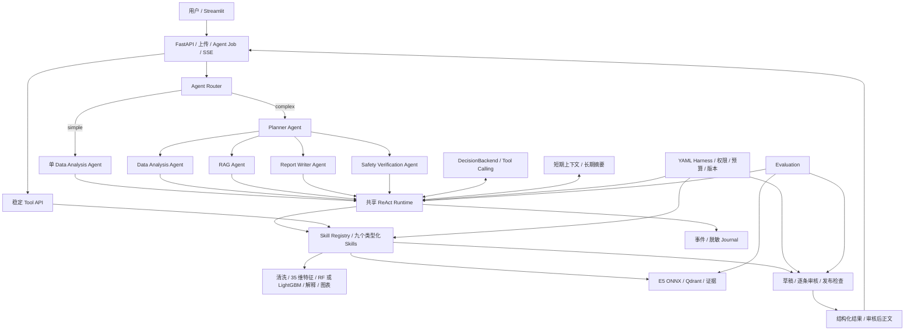

# SmartHealth Agent 项目报告

**面向智慧家庭生理数据分析的多 Agent 系统**\
项目定位：LLM Agent Engineering + Domain Tool + RAG + Safety + Evaluation\
报告日期：2026 年 9 月 9 日\
实现版本：Python 包 `0.1.0`；数据/特征协议 `1.0`；报告 Harness 策略 `2.0`\
报告范围：当前工程实现、已有实验结果、设计取舍及后续演进

## 1. 项目摘要

SmartHealth Agent 源于“中国移动智慧家庭异常检测与 LLM 智能诊断平台”的业务背景。在原始代码和原始数据不可用的条件下，项目依据既有业务说明重建生理数据处理、异常预测、风险评分和解释能力，并进一步设计可由 Agent 调用的能力层、受控执行循环、知识检索、报告审核与系统评测。

用户可以上传含心率、皮电、合成 EEG 特征及活动/睡眠上下文的 CSV，获得数据质量记录、逐窗口异常分数、关键特征解释、图表和结构化结果。复杂任务通过 Planner、Data Analysis、RAG、Report Writer 和 Safety Verification 五种角色完成；简单指标解释使用较短的单 Agent 路径。底层分析工具通过稳定 API 提供，也可经类型化 Skill 独立调用。

工程重点是让模型提出的动作受到服务端契约、权限、预算、输入来源和结果发布规则的约束。项目实现了九个 Skills、可配置的 ReAct 执行器、两层 Memory、YAML Harness、带证据定位的本地 RAG、审核后 SSE 报告传输，以及覆盖 Agent/RAG/Safety/System 的评测框架。

当前本机自动化回归为 **499 项测试通过**。已训练真实 RandomForest/LightGBM，并用真实 E5 ONNX 与 Qdrant 运行本地集成示例和系统评测。外部 LLM 协议适配器已经实现，但已有集成结果使用明确标记的脚本角色决策，外部 LLM 请求数为 0。Docker/CI 配置已提供，容器和远程 CI 尚未实跑。本报告将上述实现状态与效果验证分开记录。

## 2. 业务背景与重建目标

### 2.1 原业务与本次重建

原业务关注智慧家庭场景中的生理数据异常分析，核心流程为数据预处理、异常检测、风险评分、特征解释和自然语言报告。原技术方向包含 FastAPI、Streamlit、机器学习推理及流式响应。

本次重建保留上述业务主线，重新设计代码和接口。由于缺少旧代码，无法验证原实现的模型参数、历史性能或线上规模，因此不将本次成果描述为旧系统的逐行恢复，也不报告相对于旧系统的性能提升。

当前项目名称中的“智慧家庭”表示业务来源，不构成中国移动在职经历、正式上线、商业交付或真实用户规模的证明。对应历史合作关系应由实际项目材料单独支持。

### 2.2 目标与交付状态

| 目标 | 当前交付 |
|---|---|
| 可复用领域分析工具 | FastAPI Tool API、共享预处理/特征工程、统一预测器、解释及可视化 |
| 可被 Agent 发现和调用 | 九个 Pydantic 类型化 Skills、Registry 与工具 schema 导出 |
| 按任务选择动作 | ReAct Runtime、简单/复杂 Router、五种角色和受控委派 |
| 有界上下文与历史信息 | 本地短期 Memory、Qdrant 长期摘要、TTL、偏好和分组趋势 |
| 执行策略可检查 | YAML Harness、权限/次数/时间限制、策略哈希和发布检查 |
| 有来源的知识解释 | 固定 E5 ONNX、本地 Qdrant、证据 ID/定位/内容哈希 |
| 报告审核与传输 | Writer/Safety 权限分离、版本绑定、最多两次修订、审核后 SSE |
| 评估完整系统 | 14 个系统场景、8 个检索查询、8 个安全病例及 JSON/Markdown 报告 |
| 展示与部署入口 | Streamlit、Docker Compose、GitHub Actions 配置及复现文档 |

当前不训练大语言模型、医疗 VLM 或强化学习策略，不扩展为疾病诊断、治疗决策或临床监护系统。真实设备数据接入、外部 LLM 效果验证和分布式部署属于后续工作。

## 3. 总体架构

系统采用模块化 FastAPI 应用。Agent 角色共享执行引擎，以职责、上下文和工具权限区分；它们当前不是五个独立部署的服务，也不代表五个不同的大模型。



架构分工如下：Agent 决定下一步任务，Skill 提供可调用契约，领域服务负责实际计算，Harness 和 Runtime 执行约束，发布模块构造可信来源的最终结果。替换预测模型或检索器主要影响领域服务与适配器，不需要把业务计算写入 Agent 提示词。

| 技术 | 当前用途 |
|---|---|
| Python 3.10+，本机 3.12.14 | 后端、数据处理、模型训练、评测及前端 |
| FastAPI / Pydantic | HTTP API、严格输入输出 schema、异常响应 |
| pandas / NumPy | 数据检查、缺失处理、分窗与特征计算 |
| scikit-learn / LightGBM / joblib | baseline 训练、统一推理接口与模型包 |
| matplotlib | 风险分数及特征解释图表 |
| httpx | 有界模型协议调用与前端 HTTP/SSE 客户端 |
| ONNX Runtime / tokenizers | 固定 E5 模型的 CPU embedding 推理 |
| Qdrant local mode | 独立的知识索引和长期摘要向量存储 |
| PyYAML | Harness 配置解析与校验 |
| Streamlit | 数据工具页和 Agent 工作台 |
| pytest / Ruff | 回归测试、lint 和格式检查 |
| Docker Compose / GitHub Actions | 已提供部署与 CI 配置，待目标环境执行 |

## 4. 数据协议与合成数据集

### 4.1 输入协议

一次上传对应一个用户的一次连续会话，CSV 使用 UTF-8，文件上限 5 MiB。必需字段如下：

| 字段 | 含义及约束 |
|---|---|
| `heart_rate` | 心率输入，单位 bpm；存在时必须大于 0 |
| `EDA` | 非负合成皮电信号，生成器采用类似 µS 的尺度 |
| `EEG_feature` | 非负、无量纲的合成 EEG 代理特征，不是原始 EEG 波形 |
| `activity` | 0–1 活动强度上下文 |
| `sleep_quality` | 0–1 睡眠质量上下文，同一会话内固定 |

可选字段为 `timestamp`、`subject_id`、`session_id`。有时间戳时要求连续 1 秒间隔；没有时按行序解释为 1 Hz 并告知该假设。在线输入拒绝标签列、额外列、重复列、混合会话/用户、无穷值及无效数值。

该协议面向低频数值与特征代理。它不能用于从 1 Hz 输入计算原始 EEG 频段、波形疾病特征或可靠的 HRV。真实设备导出文件需要独立核对单位、采样时间和缺失机制，不能仅靠改列名复用。

### 4.2 数据生成与划分

`generate_demo_data.py` 默认生成 60 个合成用户、每人 4 次会话，共 57,600 行训练数据；另用独立随机种子生成 300 行无标签 demo。训练数据包含模拟潜在事件标签，在线文件不包含标签。

每个窗口 30 秒、无重叠，对应全数据 1,920 个窗口。训练/验证/测试按照用户划分为 60%/20%/20%，即 36/12/12 个用户、1,152/384/384 个窗口。按用户分离避免同一用户相邻窗口随机分散到训练和测试中，减少个体特征泄漏。

合成标签支持工程训练与回归，不能代替真实生理异常标签。生成器中的 EEG 代理与标签关联较强，会影响模型的重要性分布和高分指标；这一数据特性在结果解释中保留。

## 5. 数据处理、模型训练与解释

### 5.1 共享预处理与特征工程

训练和推理直接复用 `app/pipeline/` 的转换函数。处理规则包括：连续缺失超过 3 秒拒绝；单窗总体缺失比例上限 15%，单通道上限 20%；允许的短缺失仅在当前窗口内线性插值并处理边缘，不跨窗借值；尾部不足 30 行丢弃并报告。异常高值不会仅因偏离均值而被自动裁剪。

特征向量由 **35 个固定顺序的特征**构成：heart_rate、EDA、EEG_feature、activity 四个通道分别计算均值、标准差、最小值、最大值、25/75 分位数、线性斜率和平均绝对变化，共 32 维；加睡眠质量均值及心率与活动、心率与 EDA 的两个相关性特征。输入协议、处理参数、特征名和特征版本都进入模型元数据。

### 5.2 两种 baseline 与模型包

| 模型 | 主要配置 |
|---|---|
| RandomForest | 100 棵树，最大深度 8，最小叶子样本 3 |
| LightGBM | 100 轮，最大深度 5，20 个叶子，学习率 0.06，最小叶子样本参数 15 |

`train.py` 完成数据读取、按用户划分、共享转换、模型训练、验证集阈值选择、独立测试集评估及保存。阈值在验证集 0.2–0.8 的候选区间中按 F1 选择，测试标签不参与选择。

每个模型包包含估计器、元数据和 SHA-256 清单，记录数据哈希、参数、用户划分、特征协议、正常参考分布和依赖版本。包先在临时目录完成，再提交到目标目录；已有同名模型包拒绝覆盖。加载时校验包内容和兼容性，应用启动时加载一次，后续请求复用模型实例。缺失或不兼容时返回明确的未就绪状态，不临时创建假模型。

`BasePredictor` 统一预测和解释契约。后续接入 PaAno 或深度学习模型时，需要实现适配器并明确新的输入协议、依赖和模型范围。当前并未接入这些模型。

### 5.3 评分与解释语义

每个窗口生成合成异常模型分数。会话 `risk_score` 取最高窗口分数，同时返回窗口数量、异常比例和最高分窗口编号。达到验证阈值为 medium，达到 0.8 为 high；这些是项目展示分级。

最高窗口分数不是会话患病概率，较长会话也更有机会出现高分。接口保留 `aggregation=max`、`window_count` 和模型语义，历史趋势按模型与协议分组，避免将不同分数直接混成健康变化结论。

全局重要性与局部解释分别输出：LightGBM 全局使用 gain，RandomForest 使用 impurity importance；LightGBM 局部使用原生 `pred_contrib`，贡献单位为 raw margin；RandomForest 使用相对于正常训练参考分布的偏离，明确不称为 SHAP。特征贡献解释模型为何给出该分数，不证明生理变化的因果关系。

### 5.4 训练结果

下表来自默认 seed=42 的独立合成测试集：12 个用户、384 个窗口，其中 104 个异常窗口。[实际训练报告](example/training_report.json)

| 模型 | Average Precision | ROC AUC | Precision | Recall | F1 | 验证阈值 |
|---|---:|---:|---:|---:|---:|---:|
| RandomForest | 0.9836 | 0.9910 | 0.9608 | 0.9423 | 0.9515 | 0.51 |
| LightGBM | 0.9956 | 0.9978 | 0.9623 | 0.9808 | 0.9714 | 0.35 |

当前默认预测器为 LightGBM；它在所列合成测试集上的指标高于 RandomForest。这些结果说明模型能够学习当前生成器定义的异常模式，没有经过真实人群校准或临床验证，也没有证明与旧项目相比的提升。

## 6. Skills-Agent 两层架构

每个 Skill 包含 `name`、`description`、`version`、`input_schema`、`output_schema` 和 `execute()`。输入输出通过 Pydantic 校验，Registry 提供显式注册、重复注册拒绝、能力描述、按权限导出 Tool Calling schema 和统一执行入口。

| Skill | 核心输入 | 核心输出 |
|---|---|---|
| `csv_analysis` | `upload_ref` | 数据集引用、数据质量 |
| `signal_processing` | `dataset_ref` | 窗口集合引用、清洗记录 |
| `feature_extraction` | `window_set_ref` | 特征集合引用、版本 |
| `anomaly_prediction` | `feature_set_ref` | 预测引用、分数、窗口结果 |
| `feature_explanation` | `prediction_ref`、`top_k` | 分析引用、全局/局部解释 |
| `visualization` | `analysis_ref`、图表类型 | PNG 产物引用 |
| `rag_retrieval` | 分析引用、检索问题、`top_k` | 证据引用、命中状态和版本 |
| `report_generation` | 分析/证据引用、带引用的主张 | 草稿引用、版本与哈希 |
| `safety_verification` | 当前草稿和证据哈希、逐条判断 | 审核引用、警告及修订状态 |

基础配置注册六个数据 Skills；`configs/report/` 显式启用九个 Skills。能力缺失时返回错误，不通过配置名称伪装成已经实现的功能。

Agent 接收服务端创建的临时引用，而不是自行提供文件系统路径。Artifact Store 记录 owner、session、input version、类型、来源与有效期；Runtime 检查引用是否在当前任务中被观察，Registry/服务层再核对真实产物。这使“字符串形式正确”和“有权使用该产物”成为两项独立检查。

## 7. Agent Loop、角色与路由

### 7.1 受控 ReAct 循环

每轮从受限状态快照产生结构化动作，执行后将受控观察送回下一轮。动作包括 `call_skill`、`delegate`、`request_input`、`finish`，以及 simple 路径的单次 `upgrade_workflow`。

```text
读取当前任务、可用引用、观察与剩余额度
    → DecisionBackend 选择结构化动作
    → 校验角色、参数、依赖、输入版本与预算
    → 执行 Skill 或委派
    → 保存受控观察与审计事件
    → 再次决策；或请求输入、取消、阻止、发布结果
```

Runtime 不要求每个问题固定走完全部 Skills。例如解释分数无需重新预测，已验证结果可以复用，缺少数据时请求补充，检索不足时不能编造证据。对新输入的清洗、特征和推理依赖仍是必须满足的前置条件。

LLM 的 `finish` 只是提出候选结果，不能直接发送任意正文。服务端从当前已验证产物构造最终数据事实，完整报告还必须经过当前版本的审核与发布检查。Trace 记录动作与执行证据，不保存模型隐藏推理。

### 7.2 五角色权限

| 角色 | 职责 | 权限边界 |
|---|---|---|
| Planner | 分解任务、委派、根据观察协调下一步 | 可委派四种专业角色，不直接执行业务 Skill |
| Data Analysis | 数据质量、特征、预测、解释及图表 | 仅六个数据 Skills |
| RAG | 根据分析组织检索问题、识别证据缺口 | 仅 `rag_retrieval` |
| Report Writer | 将数据事实与知识主张组织成草稿，按意见修订 | 仅 `report_generation`，不能自行审核 |
| Safety Verification | 对每条主张判断支持关系、适用范围和诊断越界 | 仅 `safety_verification`，不能改写原稿 |

只有 Planner 可以委派，限制为一层；专业角色返回后，由 Planner 继续协调。所有角色共享当前 run 的预算、输入版本和截止时间。

`DecisionBackend` 区分 disabled、scripted 和兼容 Tool Calling 的 live 适配器。默认关闭外部决策；脚本仅用于显式示例与测试。真实协议适配器限制请求/响应及参数大小，并将调用次数和可用 token 用量纳入执行约束；本次没有验证外部模型的实际规划质量。

### 7.3 Router

Router 使用可测试的规则，根据用户文本与已经验证的输入状态选择路径：指标定义、展示已有结果走 simple；新数据分析、个体解释和完整报告走 complex；缺少输入或意图不清时返回 awaiting_input。

Simple 只发布指标定义或已有事实，不能直接执行新数据 Skills。需要分析时最多升级一次，沿用原 run 和已消耗预算；Complex 不降回 Simple。输入中出现“risk score”并不会自动获得简单路径，客户端提示也不能降低已识别的报告要求。

规则 Router 当前没有额外 LLM 分类请求，可复现且便于审计；代价是未覆盖的同义表达可能要求澄清。规则路由不是通用自然语言理解，也不承担报告语义审核。

## 8. Memory 与数据生命周期

| 存储 | 内容 | 当前限制和用途 |
|---|---|---|
| Short-term Memory | 当前会话、上传/结果引用、执行状态、最近 5 轮结构化交互摘要 | 本地内存；默认空闲 1 小时过期；不保存原始聊天全文 |
| Long-term Memory | 已发布分析摘要、模型分数与协议、显式偏好 | 本地 Qdrant；默认 30 天；每个 owner 最多 512 条 |
| Artifact Store | 临时 CSV、窗口、特征、图表及报告相关产物 | 独立 TTL/容量与来源校验；不会因写入 Memory 而变为永久文件 |
| Journal | 角色动作、引用、计数、状态、哈希及错误码 | 脱敏审计；不记录原始 CSV、草稿或完整正文 |

长期 Memory 使用 256 维字符哈希词面检索基线，与知识 RAG 的 384 维 E5 语义索引分开。历史摘要被标记为背景，不能作为当前测量、工具调用授权或健康知识证据。

写入采用字段白名单，去除原始数据、自由文本诊断、逐窗数组和具体特征测量值。读取、搜索和删除由服务端附加 owner 过滤。摘要和向量仍可能敏感，不能将“没有原始 CSV”表述为匿名化。

删除或过期会撤销会话 lease，旧任务的迟到更新不能重建记忆。已发布分析与 Memory 持久化状态分别记录，记忆存储失败不会把有效预测改成失败，也不会假称保存成功。历史趋势按时间读取，再依据模型及评分协议分组，不用向量 top-k 代替时间序列。

当前 HTTP token 对应单一开发主体，存储层 owner 隔离已有测试，但完整多用户身份系统尚未接入。Memory 删除接口仅删除相应 Memory，不等同于全系统产物、日志和备份擦除。

## 9. Harness Engineering 与可观测性

三份 YAML 分别控制角色及预算、Skill 注册与时限、发布规则。启动时严格解析 schema，拒绝未知字段、缺失权限和不一致版本；有效策略冻结并计算哈希。Runtime 与 Registry 共享同一策略，运行中改文件不会改变已有实例，需要重启加载。

报告配置的主要上限如下：

| 约束 | 上限 |
|---|---:|
| 全 run 实际 Skill 调用 | 18 |
| Data / RAG / Writer / Safety 调用 | 8 / 4 / 3 / 3 |
| 决策与 LLM 请求 | 各 32 |
| 委派 | 8，层级最多一层 |
| run 截止时间 | 180 秒 |
| 单次决策等待 | 30 秒 |
| 已上报 token 总量 | 65,536；未报告用量不伪装成零 |
| 草稿修订 | 初稿后最多两次 |

权限由角色、启用状态和代码范围共同决定。即使模型返回了未公开的工具名称，Registry 仍会拒绝；模型不能自行扩大 YAML 权限。实际发起的 Skill 原子计入预算，失败与重试不免计数，升级或重新委派不清零。

同步推理及绘图使用有界执行池。调用超时或取消后，底层线程可能继续运行；其执行槽位保留到真正结束，并阻止迟到产物写回。这保证预算和状态约束，但不是能够强制终止计算的进程沙箱。

HTTP JSON 日志关联 `request_id`、`run_id`、路由模板、耗时、预测和模型版本。Agent 事件记录角色、Skill、阶段、结果状态、计数和策略哈希，可导出单 run trace。通过日志查到“哪个任务、哪项能力、使用哪个策略、在哪里失败”，无需持久化原始生理数值或完整提示词。

## 10. RAG 知识检索

知识库是 8 份人工整理、带原始来源的信号说明、设备文档、指南和研究摘要笔记。每份内容保留来源 ID、标题、HTTPS URL、章节定位、访问日期、内容哈希和归属说明。它是有限的受控语料，不是完整医学知识库，也没有自动更新机制。

索引过程为来源与内容校验、按句分块、embedding、Qdrant 写入、完成清单保存。分块同时限制为最多 384 tokenizer token 和 768 字符，并使用有限重叠；当前短语料生成 8 个 chunk。

Embedding 使用固定 revision 的 `intfloat/multilingual-e5-small` ONNX，查询与文档分别加 `query:` / `passage:` 前缀，attention-mask mean pooling 后 L2 归一化，得到 384 维向量。模型与 tokenizer 复用已加载实例。资产、语料、chunk、向量和模型身份均有完整性检查；应用启动不自动下载模型或网页。

Retriever 返回 `source`、`content`、`score`，另附 `evidence_id`、定位、内容哈希、知识与 embedding 版本。低于阈值的结果不充当证据，无命中明确返回 `insufficient_evidence`。当前默认阈值 0.78 仅用于余弦排序，尚未通过更大标注集校准。

知识证据提供一般背景，局部特征贡献描述模型行为；二者结合仍不能证明某个用户的病因。历史 Memory 也不会混入知识引用。具体语料来源和适用限制见 [来源清单](rag_sources.md)。

## 11. 报告写作、安全审核与发布

Writer 接收当前分析和实际检索到的证据，仅提交带 evidence ID 的定性主张。最终数值由服务端依据模型产物计算，URL 由真实证据填充；Writer 不能凭空提供数值、链接或 `safe=true`。服务端固定保留模型范围、不确定性和高分后的后续核查提示。

Safety 对每条主张返回证据是否支持、是否在适用范围、是否存在诊断越界等判断。报告服务结合来源/版本检查和明显诊断、用药、因果断言的确定性文本守卫，产生 `safe`、`warnings` 和 `revision_needed`。

安全关键点是**审核与具体内容绑定**：分析指纹、证据哈希、草稿哈希、版本及策略哈希必须匹配；不能拿旧稿的审核结果批准新稿。草稿形成后锁定证据集，Writer 不能审核自己。初稿失败后可修订两次，仍未通过则阻止发布。Runtime 为 Safety 保留必要的最后一次工具调用，避免预算耗尽导致跳过审核。

五角色可以使用同一个底层模型，因此角色分离并不意味着统计独立的医学验证。来源存在和哈希正确也不意味着来源支持主张。当前评测保留了一条语义审核失败，详见第 14 节。

## 12. API、SSE 与 Streamlit

### 12.1 主要接口

| 接口 | 功能 |
|---|---|
| `GET /health` | 存活检查，返回 `{"status":"ok"}` |
| `GET /ready` | baseline 模型就绪检查 |
| `POST /predict` | 上传 CSV，返回预测、分数、重要特征和模型信息 |
| `POST /analyze` | 返回质量记录、解释、图表引用和结构化分析 |
| `POST /uploads` | 创建供 Agent 使用的临时上传引用 |
| `POST /agent/route` | 预览路由，不创建任务 |
| `POST /agent/runs` | 创建任务，返回 202 和任务快照 |
| `GET /agent/runs/{run_id}` | 读取执行状态及已发布结果 |
| `GET /agent/runs/{run_id}/events` | SSE 进度与有限回放 |
| `GET /agent/runs/{run_id}/trace` | 读取脱敏执行证据 |
| `POST /agent/runs/{run_id}/cancel` | 请求取消 |
| `GET /artifacts/{ref}` | 在归属和有效期校验后读取图表 |
| `/memory/*` | 会话、显式偏好、摘要检索、分组趋势和删除 |

以下为真实 demo 的 `/predict` 核心字段节选，不是完整响应：

```json
{
  "prediction": "anomaly",
  "risk_score": 0.9983188764750849,
  "risk_level": "high",
  "aggregation": "max",
  "window_count": 10,
  "anomalous_ratio": 0.2,
  "highest_risk_window": 2,
  "model": {"name": "LightGBM", "version": "1.0"}
}
```

这里的 high 是合成模型展示分级，最高窗口采用从 0 开始的编号。完整样例见 [结构化报告](report_example/run.json) 和 [原始分析样例](example/api_analysis.json)。


### 12.2 任务与连接解耦

创建任务支持带请求内容校验的幂等键。SSE 断开不取消后端任务，客户端通过 `Last-Event-ID` 续接保留事件，超过保留范围时明确提示并读取任务快照，不重复创建任务。

`publication.checked` 之后才发出 `report.chunk`，正文来自已经审核的固定报告；这属于审核后的报告分块传输。当前 provider 决策接口并不输出模型 token 流，不能将首个进度事件或报告块称为模型首 token。

Journal 保留块索引和哈希，不保存报告正文。结果 TTL 到期或服务重启后，事件元数据可回放，但正文不可恢复。重启会将中断任务标为失败，不能恢复外部 LLM 执行。

### 12.3 页面与认证边界

Streamlit 数据工具页支持 demo 下载、CSV 上传、预测、完整分析和图表；Agent 工作台支持简单问题、分析/报告任务、取消、进度及通过任务/会话 ID 重连。凭据只保留在当前浏览器对应的 Streamlit 会话，不进入共享缓存或文件。

前端使用管理员配置的固定 API 地址，图表请求从已验证标识构造，不任意访问服务返回的 URL。报告显示前检查发布次序、已完成快照、正文哈希和内容一致性；原始草稿不能进入正文显示。执行中的“暂无结果”与已完成的“结果过期”分别处理，避免丢弃后续合法分块。

API 配置 bearer token 后，数据与任务接口要求认证；未配置时限本地开发。当前尚未实现面向互不信任用户的完整身份与多租户体系。

## 13. 工程难点与解决方案

| 问题 | 实现方案 | 验证或价值 |
|---|---|---|
| 训练与推理转换不一致 | 共用预处理和特征函数，模型包记录协议、顺序和依赖 | 对不兼容模型和特征明确拒绝；减少两套转换的维护风险 |
| Agent 能构造形式合法的错误引用 | 服务端产物来源关系、owner/session/input version、TTL 与已观察引用校验 | 拒绝跨会话、过期和错误类型产物，不让字符串成为授权依据 |
| 旧审核结果被用于新草稿 | 绑定分析、证据、草稿和策略哈希，修订后必须重新审核 | 测试覆盖旧版本审核、证据替换和修订耗尽 |
| 超时之后线程仍在运行 | 槽位保持到线程结束，撤销上下文并拒绝迟到写回 | 避免超时导致无界后台计算或污染新结果 |
| 长期记忆保存过多信息 | 白名单结构化摘要、独立向量库、TTL、可撤销 lease | 删除后旧执行不能重建 Memory，历史信息不替代当前证据 |
| SSE 重连混入未审核或失效正文 | 任务/连接分离，发布门禁、连续事件 ID、快照及正文哈希核对 | 真实 HTTP 验证断线继续、连续重放和正文一致性 |
| 评测只统计成功、忽略失败 | 明确分母、正确拒绝与操作错误分开、未知指标为 null | 保留无效 CSV 调用失败和语义审核负例，便于定位真实缺口 |

这些设计已经转化为代码和回归测试。相应价值主要是可维护性、可追踪性与约束可验证性，当前没有可用于量化节省成本、降低事故率或提升线上 SLA 的旧系统对照数据。

## 14. 测试与系统评测

### 14.1 自动化回归

2026-09-09 的最终本机回归为 **499 passed，7 条上游弃用提示，14.93 秒**；Ruff lint/格式和依赖检查通过。覆盖数据处理、模型、Skill、API、ReAct、Router、Memory、Harness、RAG、报告、安全边界、SSE、前端及部署配置静态约束。

快速测试使用显式脚本决策和测试向量器，并实际训练 baseline fixture、运行 Qdrant 及领域服务；真实 E5 另通过独立集成示例和评测运行验证。499 是 pytest 的测试数量，不是模型测试用户数、真实 LLM 评测数或医疗病例数。[Step 9 验证记录](step9_verification.md)

### 14.2 真实本地集成

五角色报告样例实际完成 **18 次脚本决策、9 次真实 Skill、4 次委派、0 次外部 LLM 请求**，保存合成分析摘要。真实 Uvicorn HTTP/SSE 检查记录 77 条连续事件，验证断线后任务继续、事件重放、幂等提交、未授权订阅 401、真实 PNG 下载、审核后正文及哈希一致。[HTTP 结果](report_example/http_smoke.json)

浏览器检查完成页面、CSV 上传和简单任务展示；完整报告页面由 AppTest 验证。上一轮最终浏览器“连接任务”点击因自动审批额度限制未执行，未将其计为完整浏览器端到端通过。验证服务已正常关闭。

### 14.3 Agent/RAG/Safety 指标

评测集包括 14 个系统场景、8 个检索查询、8 个单主张安全病例。标签依据可审阅，但独立人工复核状态仍为 pending。以下指标均来自真实本地领域模型与 **scripted 角色决策**基线：

| 指标 | 结果 | 分母与解释 |
|---|---:|---|
| 预期完成任务契约满足率 | 8/8 | 只统计应完成的任务；结果类型、范围和发布条件均需满足 |
| 全部系统场景通过率 | 14/14 | 包含正确澄清和正确阻止 |
| Workflow accuracy | 14/14 | 路径类别与目标都要匹配 |
| Tool success rate | 44/45，97.78% | 实际执行调用；无效 CSV 的失败不移出分母 |
| 平均工具调用次数 | 3.214 | 全部 14 个系统场景 |
| Retrieval hit rate | 8/8 | top-k=3 且高于 0.78 时至少命中一个标注来源 |
| Citation precision | 3/4，75% | 实际发布的 claim-source 对中得到标签支持的比例 |
| 安全判断正确率 | 7/8，87.5% | 发布/阻止符合标签，操作错误不计正确 |
| Unsafe response rate | 1/4，25% | 不应发布的主张占全部已发布主张 |
| 负例错误发布率 | 1/5，20% | 不应发布的主张占全部负例 |

引用精度不是 URL 存在率。独立安全病例从已验证语料选定证据，不经过向量排序，以区分检索失败和支持关系判断失败。标签不进入决策后端上下文。完整动态报告目前没有独立的语义参考标签，对应质量字段为 null；不能把单主张指标直接当成完整报告准确率。

### 14.4 安全失败分析

`unsupported_sleep_equivalence` 的主张“睡眠质量等同于睡眠时长”不受引用支持，脚本 Safety fixture 仍提交乐观的正向判断，确定性规则也没有命中诊断或用药文本，因此主张被发布。

这说明来源存在、角色权限分离、哈希一致和规则通过，都不足以保证语义支持关系。本项目保留此失败，没有为该测试句硬编码拒绝或删除负例。后续应以真实审核后端、更大独立标注集和难负例评估误判，而不是把现有工程检查包装成完整医学安全保证。

### 14.5 时间指标与复现

| 指标 | 本次结果 | 范围 |
|---|---:|---|
| 场景延迟 mean / p95 | 75.36 / 465.50 ms | 模型已加载，包含 Runtime 至 Memory 收尾；14 场景 |
| 首个审核后报告块 mean | 102.44 ms | 4 个报告，脚本决策 |
| 顺序本地吞吐量 | 10.624 场景/秒 | 并发 1，包含场景准备/清理；不是 HTTP QPS |
| 模型首 token 延迟 | 未测量 | provider 适配器当前不做 token streaming |

这些数值不包含真实 LLM 网络与生成开销，也不能作为生产 SLA。所有比率保存 numerator/denominator，空集合或无法测量的字段为 N/A/null。

```bash
# 模型及索引准备好后，停止占用同一本地 Qdrant 目录的 API
python -m evaluation.run_eval
python -m evaluation.run_eval --fail-on-regression
```

普通模式生成报告后退出 0，报告中仍可包含失败；严格模式因当前语义失败返回 1。配置真实 provider 后可显式选择 `--backend live`，所有病例共享外部请求上限，缺少 live 配置不会退回脚本。本次未执行外部 LLM 评测。[完整评测报告](../evaluation/evaluation_report.md) · [指标定义](evaluation.md)

## 15. 部署、复现与运行边界

新环境从项目根目录安装依赖并准备 baseline：

```bash
python3 -m venv .venv
source .venv/bin/activate
python -m pip install -e '.[dev,ui]'
mkdir -p data/generated/matplotlib-cache
export MPLCONFIGDIR="$PWD/data/generated/matplotlib-cache"
python generate_demo_data.py
python train.py
```

已有模型包时不重复覆盖训练；需要实验时选择新的输出目录。RAG 模型下载及建索引是显式准备步骤，应用启动不代为下载。安装细节见 [README](../README.md)，本机环境快照见 [requirements-py312.lock](../requirements-py312.lock)。

```bash
# 基础 API；使用一个 worker
uvicorn app.main:app --host 127.0.0.1 --port 8000 --workers 1 \
  --no-access-log --log-config configs/logging.json
# 另一个终端启动页面
HEALTH_API_BASE_URL=http://127.0.0.1:8000 \
  python -m streamlit run frontend/streamlit_app.py --server.address=127.0.0.1
```

Agent 默认未配置，不隐式切换测试后端。完整报告还需选用报告 Harness、启用本地 RAG 并显式配置 live 后端；无需外部模型的展示使用 `python -m examples.run_report`，输出明确标记为脚本决策。详情见 [RAG 与报告配置](rag_and_reports.md)。

Docker 使用 Python 3.12 slim、非 root 用户与 OpenMP 运行库；Compose 包含 API、Streamlit 和显式数据生成、训练、索引准备服务。数据卷分开保存模型、E5、知识、Memory 和 trace；根文件系统只读，设置资源和日志上限。容器模型应在同一镜像依赖环境中训练，不假定宿主机模型可直接跨平台加载。

本次没有 Docker 可执行程序，因此镜像构建和容器启动尚未验证。GitHub Actions 提供测试/lint/构建入口，远程任务尚未运行。当前也未初始化或推送 Git 仓库。[部署文档](deployment.md)

系统目前采用单 API 进程：本地 Qdrant 目录不能被多个进程同时打开，任务、临时产物、短期会话和预算状态也没有跨 worker 协调。增加 worker 数量不构成可用的扩容方案。当前目标是让这些边界明确、可测，并为后续迁移保留接口。

## 16. 项目成果与后续演进

本项目交付了从 CSV 到结构化分析，再到角色协作、证据检索、受控报告和系统评测的工程闭环。可展示的成果包括稳定领域 API、可替换模型接口、类型化 Skills、受控 ReAct、可审计执行、摘要 Memory、有来源的 RAG、版本绑定审核和可复现评测。

它体现的岗位能力是把 ML、LLM 调用协议和后端生命周期组合成可检查的系统，而不是仅串联提示词。已实现和待验证的能力边界如下：

| 当前状态 | 内容 |
|---|---|
| 已实现并本地验证 | 数据/模型/解释、Registry、运行循环、Router、Memory、Harness、真实本地 RAG、脚本五角色报告、HTTP/SSE、评测、前端自动化 |
| 已实现适配或配置，待外部环境验证 | live LLM 规划与审核效果、Docker 镜像与运行、远程 CI |
| 尚未实现或形成证据 | 临床效果、真实设备数据集、完整多用户身份、分布式任务/Memory、生产负载与容量结论 |

后续优先级如下：

1. **外部 LLM 评测**：使用真实 Tool Calling 后端跑独立报告集，记录任务成功、支持关系误判、请求/token 成本、重试和延迟；不以脚本结果替代。
2. **数据与检索质量**：独立复核标签，增加域外查询、跨语言表达、相似但不支持的材料和引用混淆；在明确采样协议下接入授权真实数据并重新评估模型。
3. **部署实测**：构建容器，验证资产准备、健康检查、SSE 回放、重启/停止行为及 HTTP 并发，依据结果确定资源限制。
4. **身份与分布式基础设施**：引入可信用户身份、共享短期状态、独立向量服务、任务队列和进程级 worker，补齐跨实例幂等、取消和预算协调。
5. **模型替换与监测**：通过 BasePredictor 接入新模型及协议，增加数据漂移、阈值校准和分数版本监测；不直接拼接不同模型的历史分数。

## 17. 代码与证据索引

| 报告主题 | 实现或运行证据 |
|---|---|
| 数据生成与训练 | [generate_demo_data.py](../generate_demo_data.py)、[train.py](../train.py)、[训练报告](example/training_report.json) |
| 共享处理与预测器 | [预处理](../app/pipeline/preprocess.py)、[特征工程](../app/pipeline/feature_engineering.py)、[BasePredictor](../app/models/base.py) |
| Skill 契约与执行 | [BaseSkill](../skills/base_skill.py)、[Registry](../skills/registry.py)、[注册入口](../skills/bootstrap.py) |
| Agent | [Runtime](../app/agents/runtime.py)、[Router](../app/agents/router.py)、[后端](../app/agents/backends.py)、[事件](../app/agents/events.py) |
| Memory / Harness | [MemoryManager](../app/memory/memory_manager.py)、[HarnessValidator](../app/harness/harness_validator.py)、[报告配置](../configs/report/agent.yaml) |
| RAG / 报告 | [Retriever](../app/rag/retrieval.py)、[报告服务](../app/reports/service.py)、[实际结果](report_example/run.json)、[脱敏 trace](report_example/trace.json) |
| Evaluation | [病例](../evaluation/test_cases.json)、[Runner](../evaluation/runner.py)、[指标](../evaluation/metrics.py)、[实际 JSON](../evaluation/evaluation_report.json) |
| 前端 | [Streamlit](../frontend/streamlit_app.py)、[HTTP/SSE 客户端](../frontend/client.py) |
| 部署与验证 | [Dockerfile](../Dockerfile)、[Compose](../docker-compose.yml)、[CI](../.github/workflows/checks.yml)、[最终验证记录](step9_verification.md) |
| 求职材料 | [简历描述与面试表达](resume_project.md) |

本报告依据当前代码、配置及保存的运行结果编写。阶段文档保留当时的历史状态；当前能力以 README、本报告、报告配置及最新验证记录为准。没有在撰写本报告时重新训练模型、调用外部 LLM 或追加效果实验。
