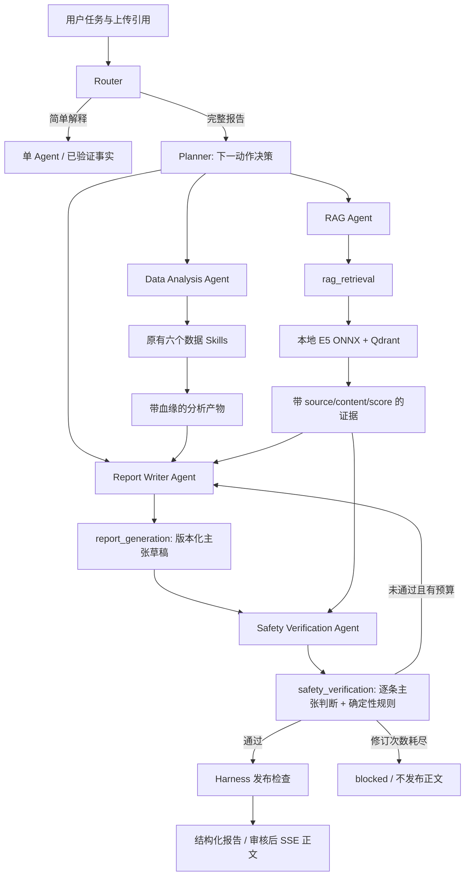

# Step 8：知识检索与报告审核

本阶段在已有 Tool API、ReAct、Router、Memory 和 Harness 上增加三个可独立注册的 Skill，以及 RAG、Report Writer、Safety Verification 三个角色。基础配置仍支持原有六个数据 Skills；`configs/report/` 显式开启九个 Skills 和五个角色。

系统生成的是**合成生理信号分析与有来源的知识解释**。数值结论来自当前模型产物；知识材料解释一般信号背景。检索相似度不能证明某个用户异常的原因。Writer 和 Safety 可以通过既有的真实 provider 适配器执行；仓库运行示例使用明确标记的脚本决策，尚未验证外部 LLM 的实际任务与审核效果。

## 架构与执行



图中的依赖由运行时强制执行，具体动作仍由每轮决策返回的 `call_skill`、`delegate`、`finish` 或 `request_input` 驱动。Planner 可以根据观察补充检索、请求修订或结束，不能绕过审核。五个角色共享 run 预算；专业角色不能继续委派，也不能调用其他角色的 Skill。

Writer 与 Safety 使用不同角色提示词和工具权限，Safety 对当前草稿及其证据独立作出逐条判断。它们可以使用同一个模型后端；这不是两个模型独立验证后的统计保证。确定性守卫负责来源、版本、数值和明显违规文本，语义支持关系仍依赖审核角色的判断。[Step 9 评测](evaluation.md) 已保留乐观脚本判断下的一条语义失败，真实 LLM 的判断效果尚未测量。

## 语料、embedding 与向量索引

`knowledge/corpus.json` 收录八份人工整理的简短笔记，包括信号说明、可穿戴设备文档、健康指南及原始研究。每份文档包含精确 HTTPS 来源、章节位置、访问日期、内容 SHA-256 和归属说明；工程适用边界与原来源事实明确区分。[来源清单](rag_sources.md) 记录具体页面与核对限制。该语料没有定时刷新机制，也不是完整医学知识库。

索引流程：

1. 严格读取有限大小的 JSON，校验来源允许列表、唯一标识和内容哈希。
2. 按句子边界切分，单 chunk 最多 384 个 tokenizer token、768 个字符，最多重叠 80 个字符；每篇最多 32 块、全库最多 256 块。索引去除完全相同的内容块。
3. 使用固定版本的 [`intfloat/multilingual-e5-small`](https://huggingface.co/intfloat/multilingual-e5-small) ONNX 模型。文档加 `passage: `，查询加 `query: `；attention-mask mean pooling 后 L2 归一化，输出 384 维向量。
4. 写入独立的本地 Qdrant collection，并保存 chunk、模型身份、语料哈希及向量哈希。完成标记最后写入。启动校验整个小型索引；不接受模型身份或内容不匹配的索引。

固定模型 revision 为 `fd1525a9fd15316a2d503bf26ab031a61d056e98`：

| 本地文件 | 字节数 | SHA-256 |
|---|---:|---|
| `model.onnx` | 470268510 | `ca456c06b3a9505ddfd9131408916dd79290368331e7d76bb621f1cba6bc8665` |
| `tokenizer.json` | 17082730 | `0b44a9d7b51c3c62626640cda0e2c2f70fdacdc25bbbd68038369d14ebdf4c39` |

运行使用 ONNX CPU provider，不训练或微调大模型。模型与 tokenizer 仅在启动时加载；查询复用实例。查询最多 1,000 字符，超过模型 512 token 输入限制返回错误，不静默截断。每次检索 `top_k` 为 1–6；返回余弦相似度 `score`、`score_type=cosine`、可定位的 `source`、`content`、`content_hash`、`evidence_id` 和版本。

默认 `HEALTH_RAG_MIN_SCORE=0.78` 是可配置的排序阈值，尚未在标注集校准；不能解释为置信度、正确率或引用支持概率。无命中时返回 `status=insufficient_evidence` 和空 hits，不补造证据。语义 embedding 仅用于知识检索；长期 Memory 仍使用 Step 6 的字符哈希检索基线，两个库及用途分开。

## 安装与构建

在项目目录执行，先按 [README](../README.md) 安装依赖并准备 baseline 模型。首次下载约 487 MB 文件，需要联网：

```bash
python -m scripts.build_knowledge_index \
  --download-model \
  --model-dir data/models/multilingual-e5-small \
  --output data/knowledge/v1
```

已有经过校验的本地模型时，省略 `--download-model`，整个索引构建离线执行。模型缓存不完整、损坏或存在同名临时下载文件会明确失败。下载脚本使用固定官方地址并校验大小与 SHA-256；服务启动从不发起下载。`data/models/`、`data/knowledge/` 已加入 `.gitignore`。

构建脚本拒绝覆盖现有索引。更新语料或模型时先构建新目录，例如 `data/knowledge/v2`，检验通过后修改管理员配置并重启；不要修改正在使用的 Qdrant 目录。同一个本地 Qdrant 索引只能由一个进程打开，因此示例脚本与 API 服务需依次运行。当前不支持多 worker、远程向量集群或索引热切换。管理员模型与索引目录必须可信；哈希检测损坏或变更，不是数字签名。

无需 API key 即可验证真实 E5、Qdrant 和 LightGBM 的数据流：

```bash
python -m examples.run_report
```

示例将 `run.json`、脱敏 `trace.json`、`report.txt`、`retrieval.json` 写入 `data/generated/report_example/`。其五角色决策和审核判断来自 `examples/report_policy.py`，输出固定标记 `review_mode=scripted_test`、外部 LLM 调用数为零。该脚本用于演示和复现，不能作为审核质量评估。测试中的 `ScriptedEmbedding` 仅在 pytest fixture 中使用，应用配置没有假 embedding 回退路径。

## 开启真实 Agent 报告接口

```bash
export HEALTH_HARNESS_CONFIG_DIR="$PWD/configs/report"
export HEALTH_RAG_MODE=local
export HEALTH_RAG_MODEL_DIR="$PWD/data/models/multilingual-e5-small"
export HEALTH_RAG_INDEX_DIR="$PWD/data/knowledge/v1"
export HEALTH_AGENT_BACKEND=openai_compatible
export HEALTH_LLM_BASE_URL=https://api.openai.com/v1
export HEALTH_LLM_MODEL=your-tool-calling-model
# 在本地设置 HEALTH_LLM_API_KEY 与 HEALTH_API_TOKEN，勿提交到版本控制。
uvicorn app.main:app --host 127.0.0.1 --port 8000 --workers 1 \
  --no-access-log --log-config configs/logging.json
```

`.env.example` 是说明文件，应用不会自动读取 `.env`。底层 `/health`、`/ready`、`/predict`、`/analyze` 保持原契约。`/ready` 检查基础模型，不表示外部 LLM 审核能力已验证。关闭报告配置或缺少检索依赖时，报告请求在路由门禁阻止，不降级成已完成的数据分析。

沿用 Agent Job API，先 `POST /uploads`，再 `POST /agent/runs`；客户端用返回的 `events_url` 订阅 SSE，读取 snapshot 获取最终结构化报告：

```python
import os
import httpx

headers = {"Authorization": f"Bearer {os.environ['HEALTH_API_TOKEN']}"}
with httpx.Client(base_url="http://127.0.0.1:8000", headers=headers, timeout=200) as client:
    with open("data/sample/demo.csv", "rb") as file:
        upload_response = client.post("/uploads", files={"file": ("demo.csv", file)})
    upload_response.raise_for_status()
    upload = upload_response.json()
    response = client.post("/agent/runs", json={
        "query": "分析这个合成CSV并生成有来源的健康分析报告",
        "session_id": upload["session_id"],
        "input_version": upload["input_version"],
        "upload_refs": [upload["upload_ref"]],
        "include_visualizations": True,
    })
    response.raise_for_status()
    run = response.json()
    with client.stream("GET", run["events_url"]) as events:
        events.raise_for_status()
        for line in events.iter_lines():
            if line.startswith("data: "):
                print(line[6:])
```

外部 provider 接收用户任务、受限的模型事实、特征名称、证据片段及审核所需草稿，不接收原始 CSV。是否允许此类信息发送到配置的服务，应由部署者的数据策略决定；当前 API 仍是单主体开发接口。

## Skill 契约与报告状态

| Skill / 执行角色 | 输入 | 输出 |
|---|---|---|
| `rag_retrieval` / RAG | `analysis_ref`、`query`、`top_k` | `evidence_ref`、`status`、`hit_count`、知识及 embedding 版本 |
| `report_generation` / Writer | 当前分析与证据引用、1–6 条带 evidence ID 的主张；修订时附前一草稿和审核引用 | `draft_ref`、版本、草稿/证据哈希、主张数量 |
| `safety_verification` / Safety | 当前草稿引用及哈希、证据哈希、每条主张的判断 | `review_ref`、`safe`、`warnings`、`revision_needed` |

完整 Pydantic 契约位于 `app/rag/schemas.py`、`app/reports/schemas.py` 及三个 Skill 适配器。每个 Skill 可经 Registry 独立调用；调用方需提供由同一 Artifact Store 创建、属于当前 owner/session/input-version 的前置产物。调用 `create_registry(service, harness=report_harness)` 后使用 `describe()` 或 `tool_definitions()` 导出 schema。不能传本地文件路径或自造引用来替代已验证产物。

Writer 仅提交定性知识主张，不能提供数值、URL、HTML、Markdown 链接或最终 `safe=true`。服务端从当前预测计算定量摘要，从实际检索命中填充 URL，并固定添加模型范围、不确定性及高分后续建议。引用必须存在，但“存在”不等于“支持”；Safety 必须判断每条主张的 `supported`、`within_scope`、`no_diagnosis` 和原因码。诊断、用药指令、个体因果断言的明显文本模式还会触发确定性拒绝。

草稿与审核绑定当前分析指纹、证据哈希、策略哈希和草稿版本。Writer 不能审核自己的稿件；Planner 不能用旧稿审核批准新稿。出现草稿后证据集锁定，避免审核期间替换来源。只有已失败的当前审核才允许修订；初稿加最多两次修订，仍失败则 `blocked/safety_review_failed`，不发布正文。

报告配置默认全局最多 18 次 Skill、32 次决策/LLM 请求、8 次委派、180 秒；各角色另有预算。运行时为 Safety 保留最后一次全局工具调用，失败和修订不会重置预算。具体值由三份 YAML 冻结并记录哈希，配置修改需重启。

## SSE、trace 与 Memory

`publication.checked` 之后才出现 `report.chunk`；每块最多 400 个字符，携带索引与报告 SHA-256。正文是在审核完成后对固定文本分块发送，不是未经审核的 LLM token 流。首次进度事件、首个报告块与模型首 token 是不同指标；当前 Evaluation 分别定义这些字段，无法测量的模型首 token 标为 `not_measured`。

断线不会取消任务；`Last-Event-ID` 可重放保留的事件。持久化 journal 和 `/trace` 只保存报告块索引、哈希、审核状态和受限执行元数据，**不保存正文、草稿或完整检索文本**。SSE 在读取时从已发布的内存结果取出正文；结果过期或重启后，块事件仍可回放，但 `content_available=false`、`text=null`，客户端不能把它解释为完整报告。

报告完成后，长期 Memory 仅保存分析摘要与分数；报告草稿、主张、证据文本和原始数据不写入长期库。短期轮次可记录此次任务的分析摘要，但当前“重显已有结果”路径仍仅支持普通数据分析结果；报告正文需在 TTL 内从原 run snapshot 读取。应用重启不能恢复原始文件、草稿或报告正文。

当前 trace 记录可审计的动作和产物引用，不记录模型隐藏推理，也不声称能从脱敏 journal 重放原始医疗数据计算。样例导出的正文和检索文本来自合成任务且由示例脚本显式写入，生产运行不会自动导出这些文件。

## 验证与评测

测试覆盖真实 Qdrant 持久化、索引篡改、模型身份、无效向量、空召回、来源及版本绑定、越权审核、修订耗尽、取消、预算、SSE 审核门禁。真实模型与 HTTP 的运行记录见 [Step 8 验证记录](step8_verification.md)。

Step 9 已增加 Evaluation、Streamlit、Docker/CI 配置及本地验证，记录见 [Step 9 验证记录](step9_verification.md)。小型标注集测量了检索命中与已发布引用支持关系，并保留安全失败；它不把脚本决策成功率当作真实 Agent 质量。后续仍需外部 LLM 的任务完成率与审核误判评估、独立标签复核、容器实测、HTTP 负载测试及分布式运行验证。
