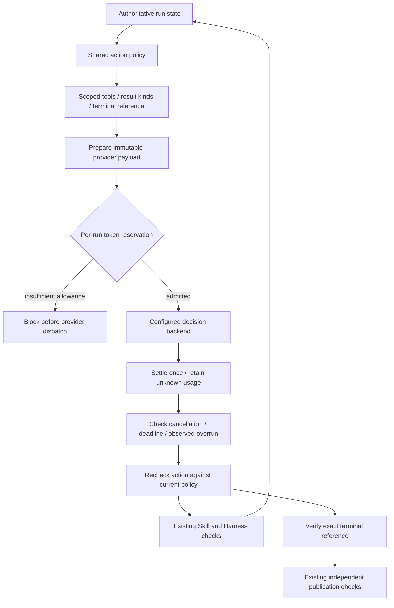

# Runtime Guard v2

## Design and scope

The local live pilot exposed three control failures: a score-definition request
was upgraded to an unavailable report workflow; a reviewer requested another
review of an unchanged, already reviewed draft; and a response crossed the
per-run token ceiling before the runtime stopped execution. The original pilot
artifacts remain unchanged in the ignored local results directory.

Guard v2 adds three controls around the existing ReAct loop. It does not replace
model decisions with a scripted workflow or relax Skill/publication validation.

1. **One state-derived action policy.** The decision view and execution guard use
   the same policy. Score definitions cannot upgrade. Other one-way upgrades
   require the server-selected route's capabilities as well as available services;
   enabling report services alone does not authorize a report upgrade. Finish schemas expose only the role's
   result kind; tools and delegates are removed when the role has a terminal
   result. Runtime validation remains authoritative even for adapters that ignore
   the supplied tool catalogue.
2. **Explicit role completion.** A current review, including a failed review,
   completes the reviewer role. The reviewer returns its exact reference; Planner
   decides whether to revise or publish, except that exhausting the existing
   revision limit blocks the run immediately. A safe current review lets Planner finish,
   but the existing publication checks still verify ownership, lineage, hashes,
   policy and scope. A new versioned draft artifact requires a new independent review. Terminal
   views contain the completion reference and status, not repeated source text.
3. **Admission before a live attempt.** The live backend prepares the exact bytes
   it will send. A per-run ledger atomically reserves serialized-request bytes as
   a conservative input-token estimate plus the output cap. Only admitted attempts
   consume the request counter. Usage from a successfully parsed `DecisionReply`
   replaces the reservation; unknown
   usage, timeout and cancellation retain allowance. Observed bound overruns block
   further work. The evaluator's cross-task request/cost ledger remains independent
   and active. A byte estimate is not a provider billing guarantee.

## Compatibility and evidence

- Existing API routes, ML pipeline, Skill schemas, source checks and approved
  report composition stay in place.
- Custom live adapters must support preparation and execution of that prepared
  request. Unsupported adapters fail closed before a network call. Scripted test
  adapters remain explicitly scripted and do not pretend to consume provider tokens.
- Run snapshots and events expose guard version, effective budget and admission /
  settlement metadata, never payloads, credentials or model reasoning.
- Recovery restores audit metadata only; it never resumes provider execution.
- Validation covers the observed failure decisions, rejected actions from
  noncompliant adapters, reviewer success/failure/revision, budget exhaustion,
  unknown usage, retry, cancellation and exact serialized payloads.

## Execution and ownership



`PreparedDecision` carries the exact request bytes and output cap without keys.
The OpenAI-compatible adapter checks ownership before execution; both evaluation
wrappers forward the same prepared object. Neither payloads nor prepared objects
are serialized into the audit journal. Scripted adapters continue through their
existing explicit testing path.

The runtime holds one token ledger across all roles and retries in a run. A
rejected admission does not increment `llm_requests`. An admitted attempt counts
even if a later transport failure or the evaluator's outer budget prevents a
response; the count is not a claim that every attempt reached the provider. The
evaluator separately records physical network dispatches. Missing or invalid
responses retain conservative allowance rather than refunding uncertain usage.

`guard_version=2.0` and `token_budget` are additive run snapshot fields. The budget
contains the effective `limit`, charged and in-flight tokens, retained unknown
tokens, known input/output usage, admitted/settled attempt counts and
`bound_exceeded`. `budget.loaded`, `budget.admitted`, `budget.rejected` and
`budget.settled` events contain the same typed metadata. Counter completeness is
independent of a task's outcome: known usage remains available after an overrun.

Run transitions are checked before journal updates. A terminal run cannot restart
decisions or dispatch Skills. Cancellation may be followed by a budget settlement,
but that settlement cannot change the terminal status or error. Recovery treats
`agent.completed` and `skill.completed` as child events, not parent completion;
an interrupted parent is marked `process_restarted` even if a child had finished.

## Implementation map

| Module | Responsibility |
|---|---|
| `runtime/action_policy.py` | State-derived action allowlists and terminal constraints |
| `runtime/token_budget.py` | Atomic reservations, single settlement, unknown-usage retention |
| `agents/contracts.py`, `agents/planner.py` | Typed terminal results, narrowed decision view |
| `agents/backends.py` | Exact payload preparation, narrowed function schemas, prepared execution |
| `agents/executor.py` | Admission, retry accounting, action revalidation and run transitions |
| `runtime/state.py`, `runtime/events.py` | In-process ledgers, scoped journal metadata, recovery |
| `evaluation/runner.py`, `evaluation/live_llm/trace_collector.py` | Preserve outer evaluation budgets around prepared requests |
| `evaluation/live_llm/graders.py` | Explicit token-admission and terminal-quiescence invariants for v2 |

## Verification — 2026-10-19

`make check PYTHON=.venv/bin/python` passed locally: **662 tests**, including 39
additional cases relative to the 623-test pre-Guard-v2 workspace, Ruff lint,
format checks for 258 Python files, and `pip check`. Seven existing upstream
deprecation warnings remain. The full pytest run took 32.60 seconds on this
machine; this is a test duration, not Agent latency or throughput.

Targeted checks can be run without credentials:

```bash
.venv/bin/python -m pytest tests/test_runtime_guard_v2.py tests/test_runtime_token_budget.py
.venv/bin/python -m pytest tests/test_agent_routing.py tests/test_report_runtime.py \
  tests/test_agent_events.py tests/test_live_runner.py
```

The new regressions cover:

- Chinese and English score queries with both provider profiles; a mocked provider
  returning the forbidden upgrade; a scripted adapter bypassing its catalogue;
  and enabled report services that still cannot expand a score-definition task.
- Successful and failed reviews, refusal to repeat an unchanged review, a valid
  revision with a new review, blocked redundant Planner delegation, and mandatory
  publication checks before report chunks.
- Exact prepared bytes despite later request-object mutation; no HTTP dispatch
  when admission fails; next-decision/retry admission; complete versus unknown
  usage; overrun accounting; concurrent reservations; foreign/double settlement;
  and cancellation with retained allowance and recovered audit metadata.
- No work after terminal state; child completion during crash recovery; rejection
  of private fields in budget metadata; and graders that detect token overruns or
  work after terminal events instead of reporting all constraints as satisfied.

Tests use explicit scripted policies, synthetic ML fixtures and HTTP mocks. No
paid evaluation was run for this change, and no change was uploaded. Seven saved
pilot evidence files were hash-checked against their original verification
receipt and remain unchanged. **Live task completion improvement is not measured
yet.** A later controlled run must use a new result directory and its own stated
request/cost allowance; do not overwrite the initial failures.

## Remaining limits

- The policy identifies an unchanged draft by artifact reference. The report
  service permits reissuing identical claims as a new version after a failed
  review; versioned hashes do not prove that claim content changed. This is not
  semantic deduplication or a guarantee that revisions address review feedback.
- A rejected provider response can contain valid usage counters, but the current
  adapter raises before returning them. Both ledgers retain the reservation and
  mark usage unknown. Such counters are not measured actual usage, and the trace
  does not preserve the name/arguments of the invalid provider action.
- Byte-based input reservations can reject requests earlier than a model-specific
  tokenizer would. A provider can still report usage beyond a reservation; v2
  records that overrun and blocks subsequent work, not already incurred charges.
- Ledgers are local to one process/run. Recovery preserves evidence and stops
  work; it does not implement distributed admission or resume paid requests.
- Only terminal decision context is compacted. Nonterminal repeated retrieval or
  other unproductive model choices remain bounded by existing limits and may
  still cause a task to fail. No model-success guarantee is inferred from tool
  availability or valid JSON.
- This change does not measure clinical correctness, semantic citation quality,
  provider streaming latency, deployment throughput or an improved live pass rate.

The [2026-10-23 live-regression plan](GUARD_V2_LIVE_REGRESSION_PLAN.md) records the
independent code audit, demonstrated grader gaps and supplemental experiment
checks. The original task grades and the frozen pre-approval plan remain unchanged.
The subsequently authorized [live regression results](GUARD_V2_LIVE_REGRESSION_RESULTS.md)
record 1/3 tasks passing, 23 provider requests and CNY 0.231930 estimated cost.
Admission blocked one request before dispatch without completing the report task;
the reviewer stage was not reached. This run does not establish improved live
task completion or a fix to the live reviewer lifecycle.
